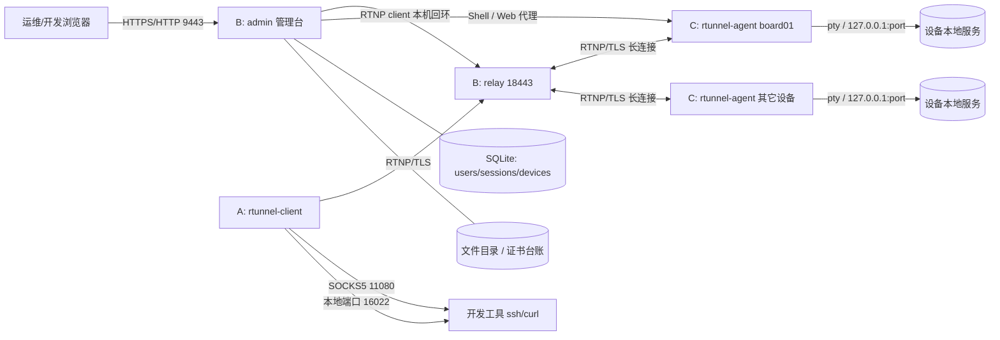
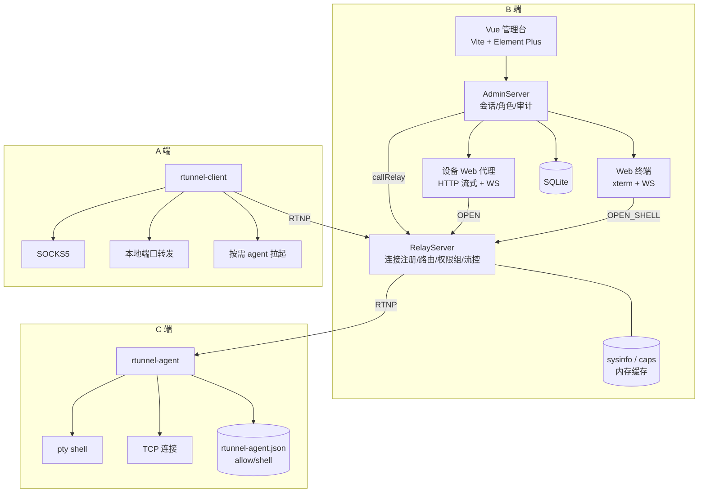
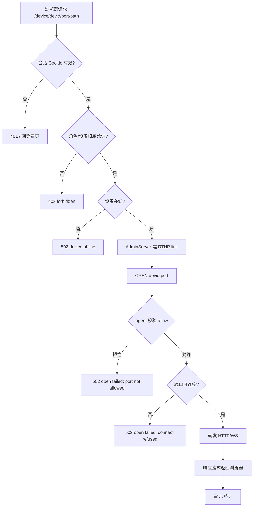
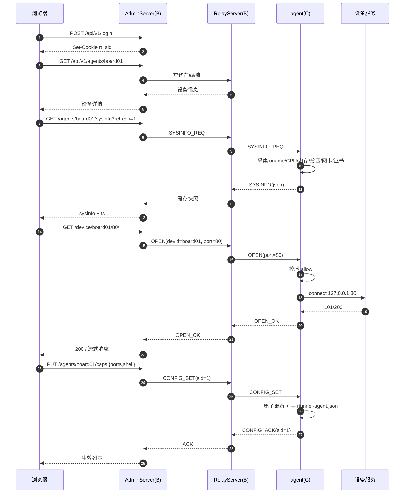
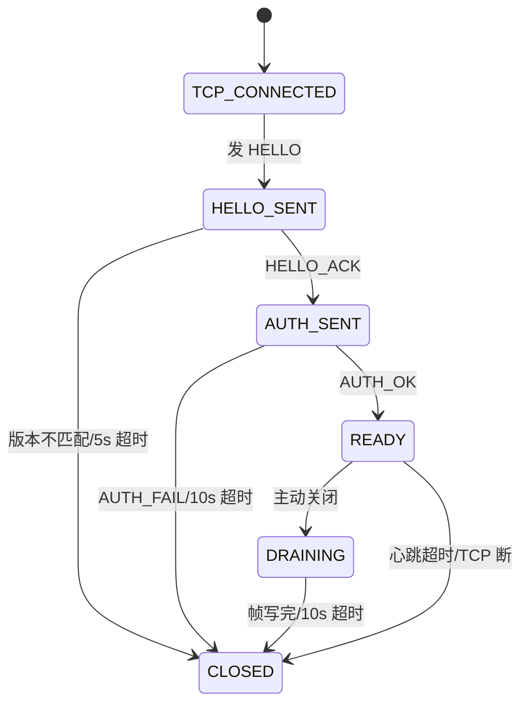
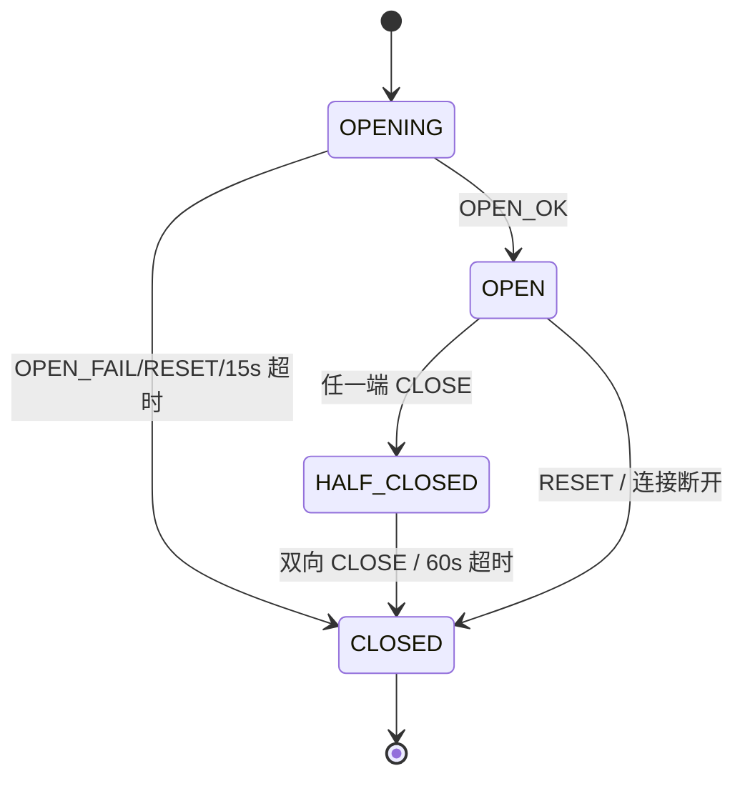

# rtunnel 图表与表格总览

本文档只放图：拓扑、业务流程、时序与状态（Mermaid + ASCII 各一份）。
协议帧表、错误码、配置项、状态与参数以 `rtunnel.md` 为准，这里不再复制一份，避免两处不同步。

目录：

1. 业务系统拓扑图
2. 业务拓扑图（模块）
3. 流程图（设备 Web 访问）
4. 时序图（登录 → 设备详情 → Web/Shell → 改能力）
5. 状态图（连接 / 会话）

---

## 1. 业务系统拓扑图

### 1.1 Mermaid



### 1.2 ASCII

```
                   ┌──────────────────────────────┐
                   │       浏览器 / 开发者         │
                   └───────┬───────────────┬──────┘
             HTTP/WS 9443  │               │ SOCKS5 11080 / 本地端口
                           ▼               ▼
                 ┌──────────────────┐   ┌──────────────────┐
                 │  B: admin 管理台  │   │  A: client       │
                 │  账号/API/代理/终端│   │  socks5/forward  │
                 └───┬──────────┬───┘   └────────┬─────────┘
                     │          │                │
             SQLite  │          │ RTNP(本机回环) │ RTNP/TLS
                     ▼          ▼                ▼
                 ┌──────┐   ┌──────────────────────────┐
                 │ DB   │   │      B: relay 18443      │
                 └──────┘   └───────┬──────────┬───────┘
                                    │ RTNP/TLS │ RTNP/TLS
                                    ▼          ▼
                          ┌─────────────┐  ┌─────────────┐
                          │ C: board01  │  │ C: 其它设备  │
                          │  agent      │  │  agent      │
                          └──────┬──────┘  └──────┬──────┘
                                 │ pty / 127.0.0.1:port
                                 ▼
                          ┌─────────────┐
                          │ 设备本地服务 │
                          └─────────────┘
```

---

## 2. 业务拓扑图（模块）

### 2.1 Mermaid



### 2.2 ASCII

```
┌─────────────────────────────── B ────────────────────────────────┐
│  Vue 管理台 ──► AdminServer ──► SQLite(users/sessions/devices)     │
│                  │  │                                             │
│       ┌──────────┘  └────────────┐                                │
│       ▼                          ▼                                │
│  设备 Web 代理               Web 终端                             │
│  HTTP 流式 + WS              xterm + WS                           │
│       │                          │                                │
│       └──────────┬───────────────┘                                │
│                  ▼                                                │
│            RelayServer 18443  ◄── sysinfo / caps 缓存             │
└──────────────────┬────────────────────────────────────────────────┘
                   │ RTNP/TLS
        ┌──────────┴──────────┐
        ▼                     ▼
┌─────── A ───────┐   ┌─────── C ─────────┐
│ rtunnel-client  │   │ rtunnel-agent     │
│ ├ SOCKS5        │   │ ├ pty shell       │
│ ├ 本地端口转发  │   │ ├ TCP 127.0.0.1:p │
│ └ 按需 agent    │   │ └ agent.json      │
└─────────────────┘   └───────────────────┘
```

---

## 3. 流程图（设备 Web 访问）

### 3.1 Mermaid



### 3.2 ASCII

```
浏览器 /device/{devid}/{port}/...
   │
   ├─ 无会话 ──────────────► 401 → 登录页
   ├─ 无权限/非本人设备 ───► 403 forbidden
   ├─ 设备离线 ────────────► 502 device offline
   ▼
AdminServer 建 RTNP link
   │
   ├─ OPEN(devid, port)
   ▼
agent 校验 allow 列表
   ├─ 不在列表 ────────────► 502 port not allowed
   ├─ 端口无服务 ──────────► 502 connect refused
   ▼
连接 127.0.0.1:port
   │
   ├─ HTTP：响应头到达即 chunked 流式回写
   └─ WS：二次握手后帧级双向转发
   ▼
浏览器（Cookie 前缀隔离、审计）
```

---

## 4. 时序图

### 4.1 Mermaid



### 4.2 ASCII

```
浏览器            AdminServer(B)        RelayServer(B)         agent(C)          设备服务
  │                    │                     │                    │                 │
  │ POST /login        │                     │                    │                 │
  │───────────────────►│                     │                    │                 │
  │◄── Set-Cookie ─────│                     │                    │                 │
  │                    │                     │                    │                 │
  │ GET /agents/board01│                     │                    │                 │
  │───────────────────►│── 查询 ────────────►│                    │                 │
  │◄── 设备详情 ───────│◄────────────────────│                    │                 │
  │                    │                     │                    │                 │
  │ GET /sysinfo?refresh=1                   │                    │                 │
  │───────────────────►│── SYSINFO_REQ ─────►│── SYSINFO_REQ ────►│                 │
  │                    │                     │                    │ 采集系统信息     │
  │                    │                     │◄── SYSINFO(json) ──│                 │
  │◄── sysinfo + ts ───│◄── 缓存快照 ────────│                    │                 │
  │                    │                     │                    │                 │
  │ GET /device/board01/80/                  │                    │                 │
  │───────────────────►│── OPEN(80) ────────►│── OPEN(80) ───────►│                 │
  │                    │                     │                    │── connect ─────►│
  │                    │                     │◄── OPEN_OK ────────│◄── 200 ─────────│
  │◄── 200 / 流式 ─────│◄── OPEN_OK ─────────│                    │                 │
  │                    │                     │                    │                 │
  │ PUT /caps{ports,shell}                   │                    │                 │
  │───────────────────►│── CONFIG_SET ──────►│── CONFIG_SET ─────►│                 │
  │                    │                     │                    │ 更新+写配置文件  │
  │                    │                     │◄── CONFIG_ACK ─────│                 │
  │◄── 生效列表 ───────│◄── ACK ─────────────│                    │                 │
```

---

## 5. 状态图

### 5.1 Mermaid（连接）



### 5.2 Mermaid（会话流）



### 5.3 ASCII

```
连接：
  [*] ──TCP──► TCP_CONNECTED ──HELLO──► HELLO_SENT
                                          │  HELLO_ACK
                                          ▼
                                      AUTH_SENT ──AUTH_OK──► READY
                                          │                    │
                               AUTH_FAIL/10s                 │ 主动关闭
                                          ▼                    ▼
                                       CLOSED ◄── 心跳超时 ── DRAINING ──10s──► CLOSED

会话：
  [*] ──OPEN──► OPENING ──OPEN_OK──► OPEN
                   │                   │
        OPEN_FAIL/RESET/15s     任一端 CLOSE
                   │                   ▼
                   │              HALF_CLOSED
                   │                   │ 双向 CLOSE / 60s
                   ▼                   ▼
                 CLOSED ◄──────────────┘
```

---

## 6. 其余表格

协议帧（§8.2）、错误码（§8.3）、状态机（§8.4）、配置项（§13）、
不变量与超时（附录 A）都在 `rtunnel.md`，本文档不重复维护。
