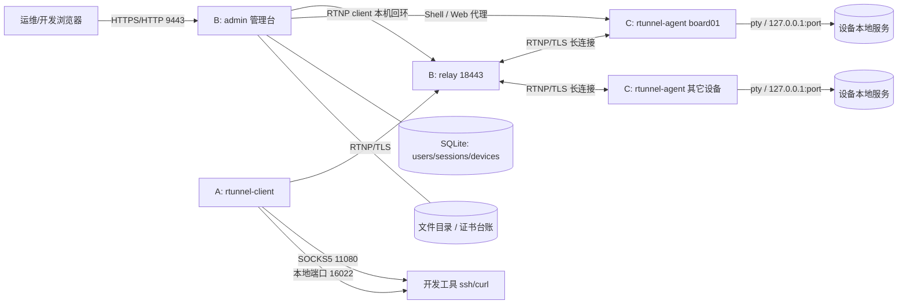
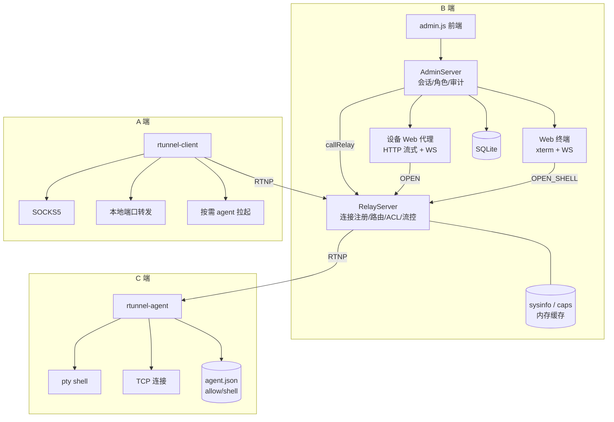
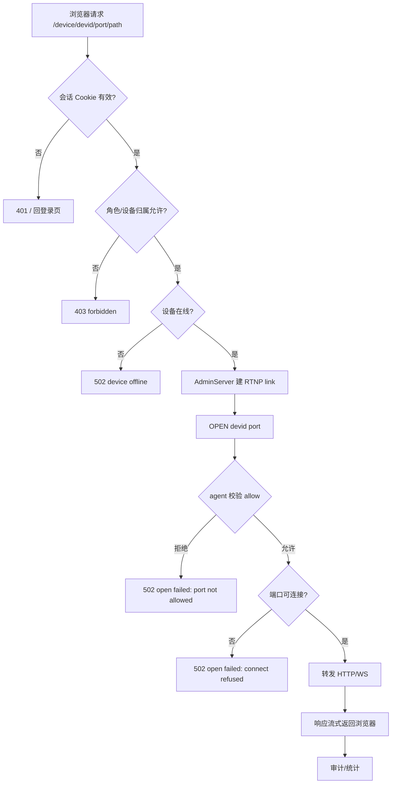
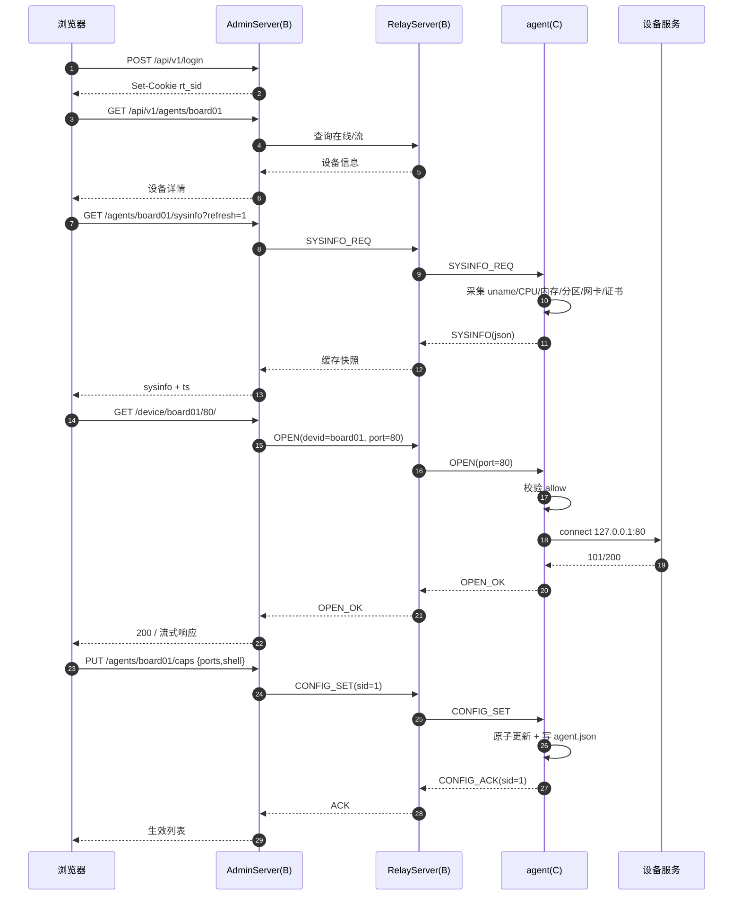
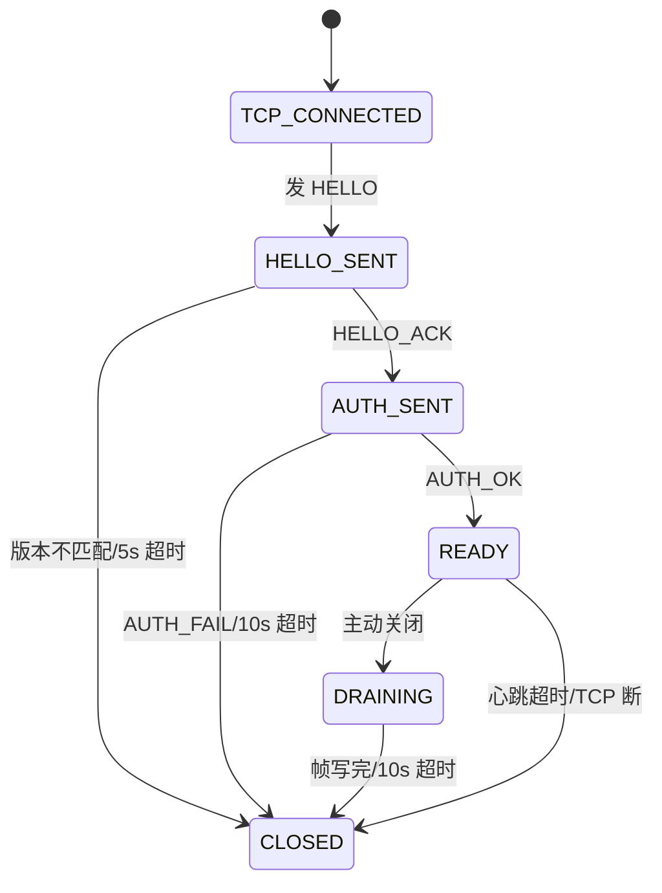
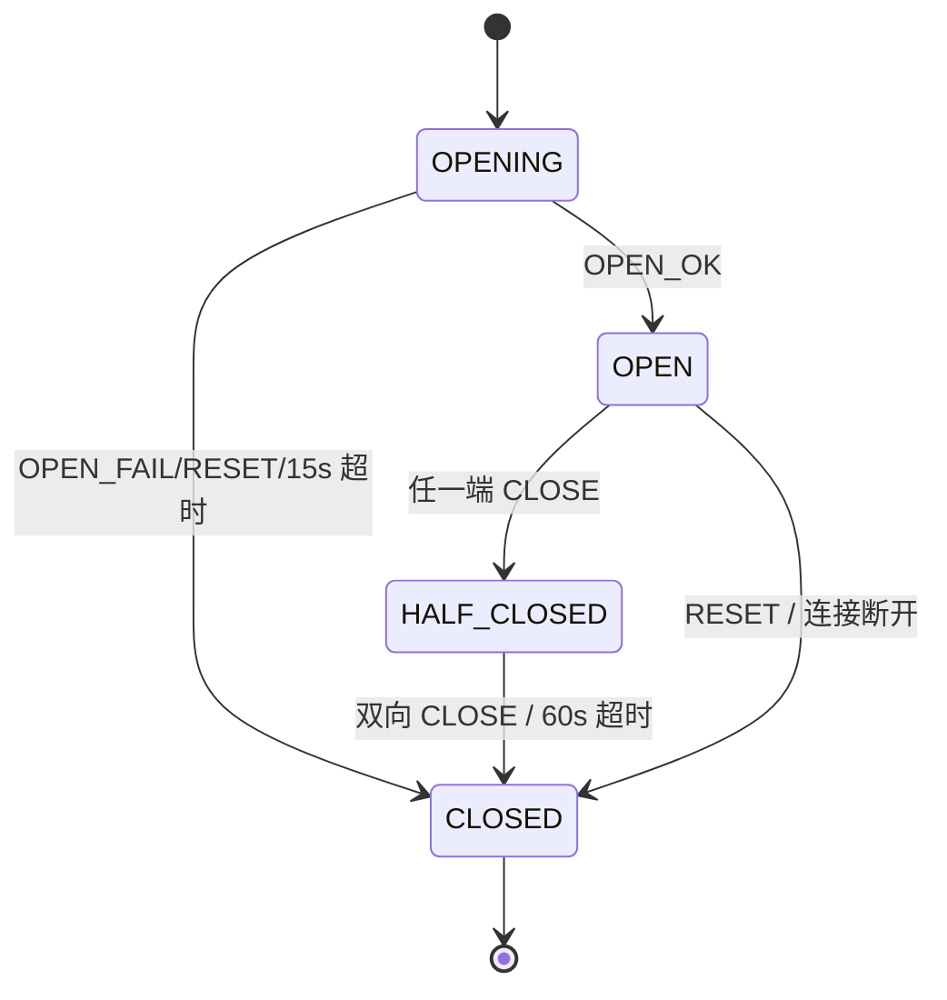

# rtunnel 图表与表格总览

本文档给出与 `rtunnel.md` 配套的全部图（Mermaid + ASCII 各一份）与关键表格。
图与 `rtunnel/README.md`、`docs/design/rtunnel.md` 的实现保持一致。

目录：

1. 业务系统拓扑图
2. 业务拓扑图（模块）
3. 流程图（设备 Web 访问）
4. 时序图（登录 → 设备详情 → Web/Shell → 改能力）
5. 状态图（连接 / 会话）
6. 协议定义表
7. 关键配置表
8. 关键状态表
9. 关键参数表

---

## 1. 业务系统拓扑图

### 1.1 Mermaid



### 1.2 ASCII

```
                   ┌──────────────────────────────┐
                   │       浏览器 / 开发者         │
                   └───────┬───────────────┬──────┘
             HTTP/WS 9443  │               │ SOCKS5 11080 / 本地端口
                           ▼               ▼
                 ┌──────────────────┐   ┌──────────────────┐
                 │  B: admin 管理台  │   │  A: client       │
                 │  账号/API/代理/终端│   │  socks5/forward  │
                 └───┬──────────┬───┘   └────────┬─────────┘
                     │          │                │
             SQLite  │          │ RTNP(本机回环) │ RTNP/TLS
                     ▼          ▼                ▼
                 ┌──────┐   ┌──────────────────────────┐
                 │ DB   │   │      B: relay 18443      │
                 └──────┘   └───────┬──────────┬───────┘
                                    │ RTNP/TLS │ RTNP/TLS
                                    ▼          ▼
                          ┌─────────────┐  ┌─────────────┐
                          │ C: board01  │  │ C: 其它设备  │
                          │  agent      │  │  agent      │
                          └──────┬──────┘  └──────┬──────┘
                                 │ pty / 127.0.0.1:port
                                 ▼
                          ┌─────────────┐
                          │ 设备本地服务 │
                          └─────────────┘
```

---

## 2. 业务拓扑图（模块）

### 2.1 Mermaid



### 2.2 ASCII

```
┌─────────────────────────────── B ────────────────────────────────┐
│  admin.js ──► AdminServer ──► SQLite(users/sessions/devices)      │
│                  │  │                                             │
│       ┌──────────┘  └────────────┐                                │
│       ▼                          ▼                                │
│  设备 Web 代理               Web 终端                             │
│  HTTP 流式 + WS              xterm + WS                           │
│       │                          │                                │
│       └──────────┬───────────────┘                                │
│                  ▼                                                │
│            RelayServer 18443  ◄── sysinfo / caps 缓存             │
└──────────────────┬────────────────────────────────────────────────┘
                   │ RTNP/TLS
        ┌──────────┴──────────┐
        ▼                     ▼
┌─────── A ───────┐   ┌─────── C ─────────┐
│ rtunnel-client  │   │ rtunnel-agent     │
│ ├ SOCKS5        │   │ ├ pty shell       │
│ ├ 本地端口转发  │   │ ├ TCP 127.0.0.1:p │
│ └ 按需 agent    │   │ └ agent.json      │
└─────────────────┘   └───────────────────┘
```

---

## 3. 流程图（设备 Web 访问）

### 3.1 Mermaid



### 3.2 ASCII

```
浏览器 /device/{devid}/{port}/...
   │
   ├─ 无会话 ──────────────► 401 → 登录页
   ├─ 无权限/非本人设备 ───► 403 forbidden
   ├─ 设备离线 ────────────► 502 device offline
   ▼
AdminServer 建 RTNP link
   │
   ├─ OPEN(devid, port)
   ▼
agent 校验 allow 列表
   ├─ 不在列表 ────────────► 502 port not allowed
   ├─ 端口无服务 ──────────► 502 connect refused
   ▼
连接 127.0.0.1:port
   │
   ├─ HTTP：响应头到达即 chunked 流式回写
   └─ WS：二次握手后帧级双向转发
   ▼
浏览器（Cookie 前缀隔离、审计）
```

---

## 4. 时序图

### 4.1 Mermaid



### 4.2 ASCII

```
浏览器            AdminServer(B)        RelayServer(B)         agent(C)          设备服务
  │                    │                     │                    │                 │
  │ POST /login        │                     │                    │                 │
  │───────────────────►│                     │                    │                 │
  │◄── Set-Cookie ─────│                     │                    │                 │
  │                    │                     │                    │                 │
  │ GET /agents/board01│                     │                    │                 │
  │───────────────────►│── 查询 ────────────►│                    │                 │
  │◄── 设备详情 ───────│◄────────────────────│                    │                 │
  │                    │                     │                    │                 │
  │ GET /sysinfo?refresh=1                   │                    │                 │
  │───────────────────►│── SYSINFO_REQ ─────►│── SYSINFO_REQ ────►│                 │
  │                    │                     │                    │ 采集系统信息     │
  │                    │                     │◄── SYSINFO(json) ──│                 │
  │◄── sysinfo + ts ───│◄── 缓存快照 ────────│                    │                 │
  │                    │                     │                    │                 │
  │ GET /device/board01/80/                  │                    │                 │
  │───────────────────►│── OPEN(80) ────────►│── OPEN(80) ───────►│                 │
  │                    │                     │                    │── connect ─────►│
  │                    │                     │◄── OPEN_OK ────────│◄── 200 ─────────│
  │◄── 200 / 流式 ─────│◄── OPEN_OK ─────────│                    │                 │
  │                    │                     │                    │                 │
  │ PUT /caps{ports,shell}                   │                    │                 │
  │───────────────────►│── CONFIG_SET ──────►│── CONFIG_SET ─────►│                 │
  │                    │                     │                    │ 更新+写配置文件  │
  │                    │                     │◄── CONFIG_ACK ─────│                 │
  │◄── 生效列表 ───────│◄── ACK ─────────────│                    │                 │
```

---

## 5. 状态图

### 5.1 Mermaid（连接）



### 5.2 Mermaid（会话流）



### 5.3 ASCII

```
连接：
  [*] ──TCP──► TCP_CONNECTED ──HELLO──► HELLO_SENT
                                          │  HELLO_ACK
                                          ▼
                                      AUTH_SENT ──AUTH_OK──► READY
                                          │                    │
                               AUTH_FAIL/10s                 │ 主动关闭
                                          ▼                    ▼
                                       CLOSED ◄── 心跳超时 ── DRAINING ──10s──► CLOSED

会话：
  [*] ──OPEN──► OPENING ──OPEN_OK──► OPEN
                   │                   │
        OPEN_FAIL/RESET/15s     任一端 CLOSE
                   │                   ▼
                   │              HALF_CLOSED
                   │                   │ 双向 CLOSE / 60s
                   ▼                   ▼
                 CLOSED ◄──────────────┘
```

---

## 6. 协议定义表

### 6.1 连接级（stream_id = 0）

| type | 名称 | 方向 | payload |
|---|---|---|---|
| `0x01` | `HELLO` | 双向 | `u8 role`(1=C,2=A) + `u8 ver` + `str agent_ver` + `u32 caps` |
| `0x02` | `HELLO_ACK` | B→对端 | `u16 max_payload + u8 auth + u32 keepalive + u32 caps` |
| `0x03` | `AUTH` | 双向 | C：`str devid`；A：`str user + u8 type + str token` |
| `0x04` | `AUTH_OK` | B→对端 | `str devid + u32 keepalive` |
| `0x05` | `AUTH_FAIL` | B→对端 | `u16 code + str msg` |
| `0x06/0x07` | `PING/PONG` | 双向 | `u64 时间戳` / 回显 |
| `0x08/0x09` | `DEVICE_QUERY/STATUS` | A↔B | `str devid` / `str devid+u8 online+u32 streams` |
| `0x0F` | `ERROR` | 双向 | `u16 code + str msg` |
| `0x18` | `SPAWN_AGENT` | B→A | `str devid`（按需拉起） |
| `0x19` | `SYSINFO_REQ` | B→C | 空 |
| `0x1A` | `SYSINFO` | C→B | `str json` |
| `0x1B` | `CONFIG_SET` | B→C | `str json {ports?,shell?}`，sid 为请求号 |
| `0x1C` | `CONFIG_ACK` | C→B | `str json {ok,ports,shell,persisted}`，sid 回显 |

### 6.2 会话级（stream_id > 0）

| type | 名称 | 方向 | payload |
|---|---|---|---|
| `0x10` | `OPEN` | A→B / B→C | `str devid + u16 port`（flags 0x0001=OPEN_SHELL） |
| `0x11` | `OPEN_OK` | C→B→A | `str host + u16 port` |
| `0x12` | `OPEN_FAIL` | C/B→A | `u16 code + str msg` |
| `0x13` | `DATA` | 双向 | 原始字节 |
| `0x14` | `WINDOW` | 双向 | `u32 credit` |
| `0x15` | `CLOSE` | 双向 | 空（本方向 EOF） |
| `0x16` | `RESET` | 双向 | `u16 code` |
| `0x17` | `RESIZE` | A→C | `u16 cols + u16 rows` |

### 6.3 错误码

| code | 名称 | 含义 | 代理返回 |
|---|---|---|---|
| 0 | OK | 成功 | 200 |
| 1 | UNAUTHORIZED | 认证失败 | 401/502 |
| 2 | DEVICE_OFFLINE | 设备不在线 | 502 device offline |
| 3 | TARGET_REFUSED | 目标不可达 | 502 connect refused |
| 4 | TIMEOUT | OPEN 超时 | 504 |
| 5 | PROTOCOL_ERROR | 帧/状态非法 | 502 |
| 6 | LIMIT_EXCEEDED | 超并发/流控 | 503 |
| 7 | ACL_DENIED | 权限不足 | 403 |
| 8 | DEVICE_REPLACED | 被新连接顶替 | 502 |
| 9 | TARGET_NOT_ALLOWED | 端口白名单拒绝 | 502 port not allowed |
| 10 | CLOSE_TIMEOUT | 半关闭超时 | — |
| 11 | CANCELLED | OPEN 前取消 | — |

---

## 7. 关键配置表

### 7.1 relay（B）

| 参数 | 默认 | 说明 |
|---|---|---|
| `--port` | 18443 | 隧道监听端口 |
| `--host` | 0.0.0.0 | 监听地址 |
| `--acl` / `--acl-file` | — | `user=devid` 规则 |
| `--client-users` | — | A 端 `user:token` 清单 |
| `--client-token` | — | A 端全局 token（与 users 二选一） |
| `--shell-users` | — | 允许 `OPEN_SHELL` 的用户 |
| `--tls-cert/--tls-key/--tls-ca` | — | 隧道 TLS/mTLS |
| `--admin` | 关闭 | 管理台监听地址 |
| `--admin-token` | — | 仅初始化 admin 用 |
| `--admin-db` | rtunnel-admin.db | SQLite 账号库 |
| `--admin-file-dir` | — | 文件管理根目录 |
| `--admin-ca-cert/--admin-ca-key/--admin-cert-dir` | — | 证书签发与台账 |
| `--admin-shell-user/--admin-shell-token` | — | 管理台连本机 relay 的身份 |
| `--drain-timeout` | 10000 | 优雅退出等待（ms） |

### 7.2 agent（C）

| 参数 | 默认 | 说明 |
|---|---|---|
| `--server/--port` | — | 指向 B relay |
| `--devid` | — | 设备标识（证书 SAN） |
| `--allow` | — | 允许访问的本地端口列表 |
| `--allow-shell` | 关 | 允许 `OPEN_SHELL` |
| `--config-file` | `/opt/data/etc/agent.json` | 能力持久化文件（运行期修改） |
| `--tls-ca/--tls-cert/--tls-key` | — | mTLS |
| `--max-idle` | 0 | 按需 agent 未使用自退秒数 |

### 7.3 client（A）

| 参数 | 默认 | 说明 |
|---|---|---|
| `--server/--port` | — | 指向 B relay |
| `--user/--token` | — | A 端身份 |
| `--socks5` | — | 本地 SOCKS5 监听 |
| `--forward` | — | `本地端口=devid:远端端口` |
| `--allow-shell` | 关 | 允许管理台按需拉起本机 agent |
| `--agent-idle` | 15 | 按需 agent 空闲退出秒数 |

### 7.4 管理台账号

| 项 | 值 |
|---|---|
| 角色 | admin（唯一）/ manager / operator / viewer |
| 口令 | 最短 8 位，PBKDF2-HMAC-SHA256 |
| 会话 | HttpOnly `rt_sid`，默认 12h（可配置） |
| 锁定 | 默认 5 次失败锁 5 分钟（可配置） |
| 初始化 | `--admin-token` 仅放行 `/api/v1/setup*` |

---

## 8. 关键状态表

### 8.1 连接 / 会话

| 对象 | 状态 | 迁移条件 |
|---|---|---|
| 连接 | TCP_CONNECTED | TCP 建连 |
| | HELLO_SENT | 发 HELLO |
| | AUTH_SENT | 收 HELLO_ACK |
| | READY | AUTH_OK |
| | DRAINING | 主动关闭 |
| | CLOSED | 超时/断链/协议错误 |
| 会话流 | OPENING | 发/收 OPEN |
| | OPEN | OPEN_OK |
| | HALF_CLOSED | 任一端 CLOSE |
| | CLOSED | 双向 CLOSE / 60s / RESET |

### 8.2 设备与账号

| 对象 | 状态 | 说明 |
|---|---|---|
| 设备 | online | 注册表在册 |
| | offline | 心跳超时/断开 |
| | draining | relay 退出中 |
| agent 能力 | ports | `allow` 列表（≤32） |
| | shell | 是否允许 OPEN_SHELL |
| | mtls | 是否有客户端证书 |
| 账号 | active | 可登录 |
| | disabled | 禁止登录、会话吊销 |
| 会话 | valid | 未过期且账号 active |
| | expired/revoked | 超时或改密/禁用 |

### 8.3 设备代理

| 状态 | 触发 |
|---|---|
| 401 | 无会话 |
| 403 | 无权限/非本人设备 |
| 502 port not allowed | agent 白名单拒绝 |
| 502 connect refused | 目标端口无服务 |
| 502 device offline | 设备不在线 |
| 503 | 并发超过 32 |

---

## 9. 关键参数表

| 参数 | 值 | 位置 |
|---|---|---|
| RTNP 版本 | 1 | 协议 |
| 帧头 | 16 字节 | 协议 |
| 单帧上限 | 64 KiB | `MAX_PAYLOAD` |
| 初始 credit | 256 KiB | 流控 |
| 心跳间隔 | 15s | relay |
| 心跳超时 | 45s | relay |
| HELLO 超时 | 5s | 握手 |
| AUTH 超时 | 10s | 握手 |
| OPEN 超时 | 15s | 会话 |
| 半关闭等待 | 60s | 会话 |
| drain 超时 | 10s（可配） | relay |
| 代理并发上限 | 32 | 设备 Web |
| 代理响应 | chunked 流式，无大小上限 | 设备 Web |
| SYSINFO 等待 | 2s | 管理台 |
| CONFIG_ACK 等待 | 2s | 管理台 |
| sparkline 采样 | 5s × 60 点 | 前端 |
| 文件上传上限 | 默认 32 MiB（可配置） | 管理台 |
| 会话有效期 | 默认 12h（可配置） | 账号 |
| 登录失败锁定 | 默认 5 次 / 5 分钟（可配置） | 账号 |
