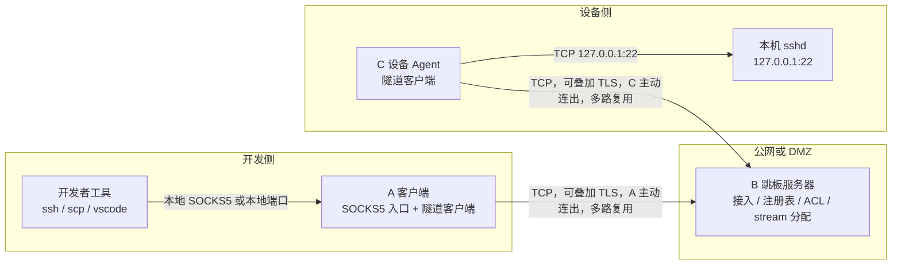
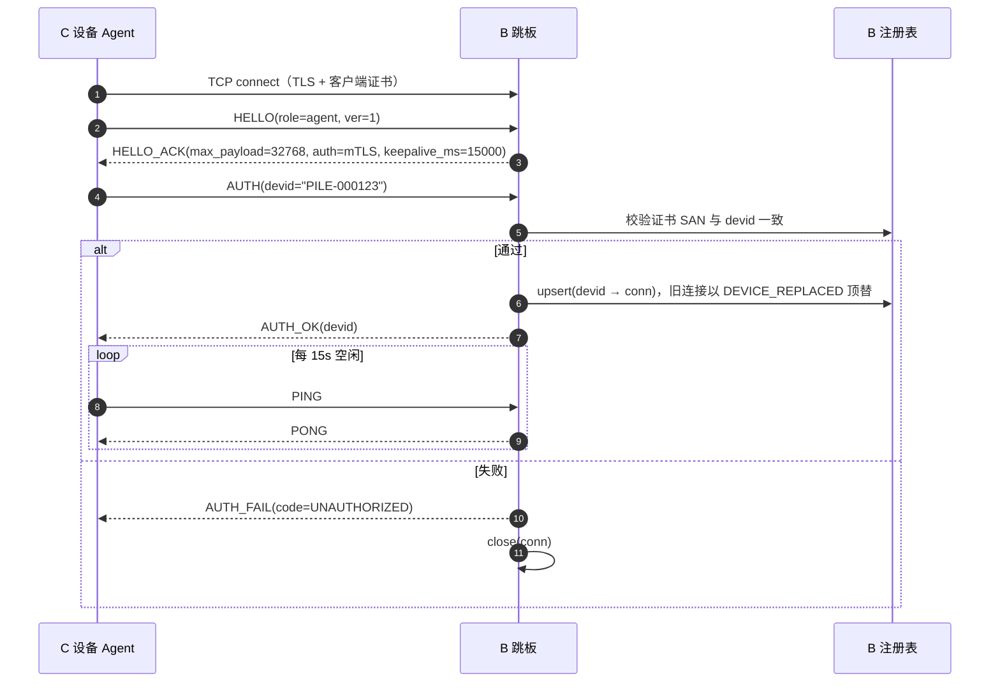
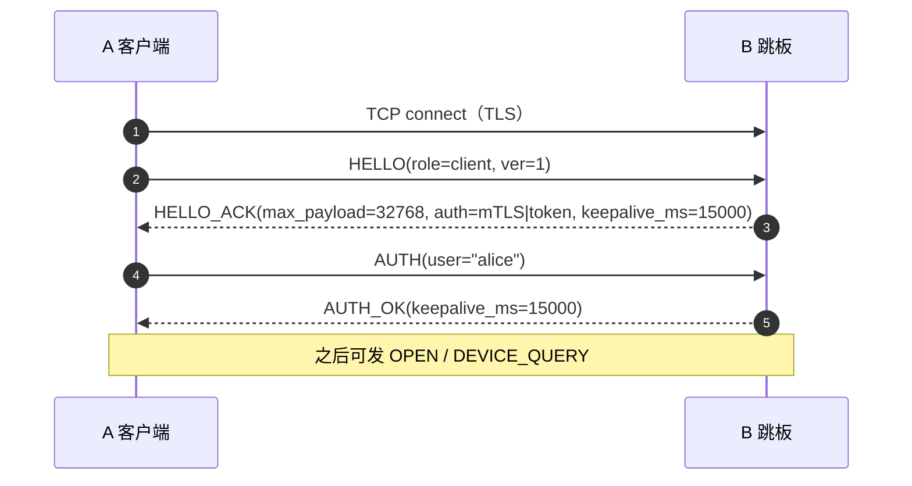
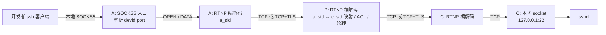
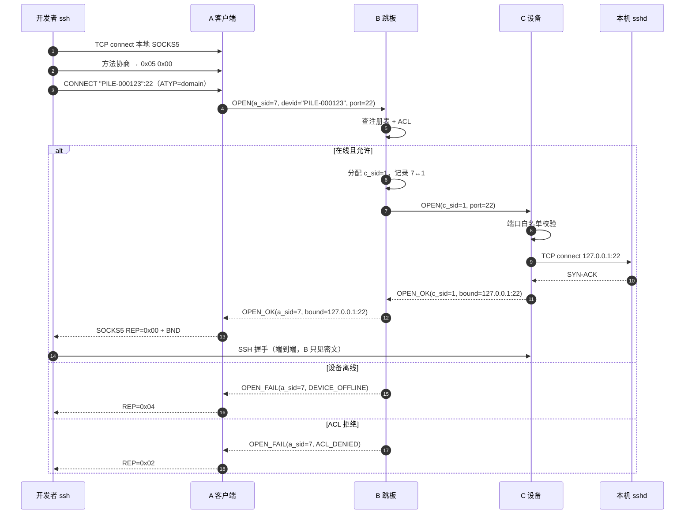
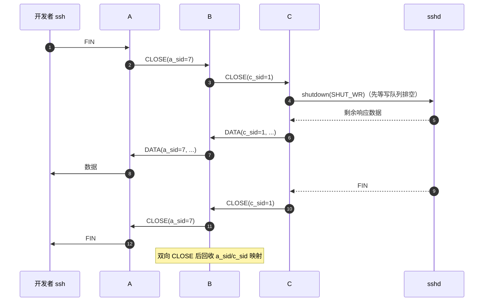
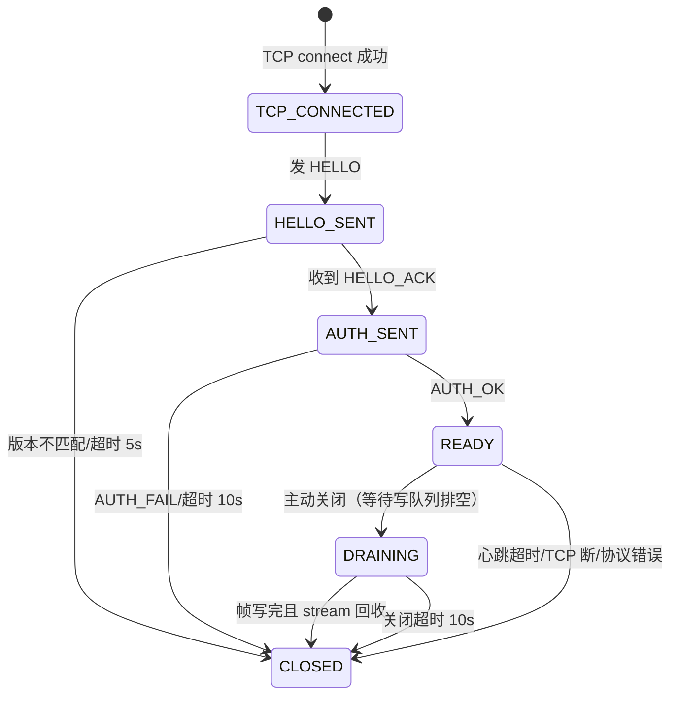
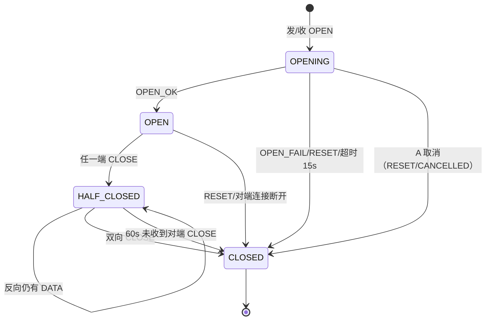

# 反向通道 rtunnel 设计（A → B → C）

> 一句话：设备与开发机都主动外连跳板，跳板按设备 ID 转发字节，形成一条**反向通道**。
> 承载范围：任意 TCP 应用——SSH / scp / HTTP / HTTPS / WebSocket / HTTP/2 / gRPC / 数据库协议等；
> 隧道不解析上层协议，只搬字节。不支持 UDP：HTTP/3、QUIC、DNS over UDP 都无法承载。

> 传输：A↔B、B↔C 均为 **TCP**（TLS 作为加密层，生产开启）
> 关联：`docs/cn/socks5.md`、`examples/socks5_proxy_server.c`、`event/socks5.c`

---

## 1. 目标与非目标

### 1.1 目标

- 开发者在自己的电脑（A）上，用标准 SSH 客户端访问任意在线设备（C）的本地 sshd。
- A 与 C 都**主动外连** B，不需要公网 IP、不需要端口映射。
- 一条 A↔B、一条 B↔C 的长连接承载**多路并发会话**，互不阻塞。
- 复用现有工具链：`ssh`、`scp`、`vscode remote`、`proxychains`、`curl`。

### 1.2 非目标（v1）

- 不做通用 VPN、不做 UDP 转发。
- 不支持从 C 访问设备内网其他主机（仅 `127.0.0.1`）。
- 不做设备发现/端口扫描。
- 不承担设备业务协议（OCPP 等）；本隧道是运维旁路。

---

## 2. 术语

| 术语 | 含义 |
|---|---|
| **A（Client）** | 开发者侧客户端。本地 SOCKS5 入口或端口映射，把流量塞进隧道 |
| **B（Relay）** | 跳板服务器。接入、设备注册表、鉴权、stream 分配与路由 |
| **C（Agent）** | 设备侧 agent。连 B、上报 devid、执行「连本地 sshd」并透传字节 |
| **devid** | 设备唯一标识，命名规则见 §8.5 |
| **a_sid / c_sid** | A↔B 段与 B↔C 段各自的 stream_id，由 B 映射（§10） |
| **a:\<user\>** | A 侧按需 agent 的 devid：shell 落在开发者机器上，而不是设备 |
| **admin** | B 上的管理台：HTTP API + WebSocket 终端 + 内嵌前端 |
| **RTNP** | 反向通道协议（Reverse Tunnel Protocol），运行在 TCP 之上 |

---

## 3. 拓扑与角色

### 3.1 拓扑



- A 与 C 之间没有直接连接，各自与 B 建一条长连接，B 按 stream 转发字节。
- B 是唯一知道「哪些设备在线」的一方，也是唯一能做 ACL 的位置。
- SSH 是 A 上的客户端 ↔ C 的 sshd **端到端**；A/B/C 只搬字节，不解析 SSH。

### 3.2 角色边界

| 组件 | 职责 | 明确不做 |
|---|---|---|
| **A** | 本地 SOCKS5 入口；登录 B；把 `devid:port` 转成 OPEN；维护 a_sid；双向搬运；逐跳流控 | 不做 DNS；不解析 SSH；不接受 IP 形式目标 |
| **B** | 接入与认证；devid 注册表；ACL；**分配 c_sid**；双向 id 映射；帧转发与轮转调度 | 不解析业务协议；不做 SOCKS5；不改写 payload |
| **C** | 登录 B 并上报 devid；保活重连；执行 OPEN（固定 `127.0.0.1:port`）；端口白名单 | 不解析 SSH；不访问非回环地址 |

---

## 4. 关键设计决策

| 编号 | 决策 | 理由 |
|---|---|---|
| D1 | **SOCKS5 只在 A 一处出现**，B/C 不实现 SOCKS5 | 隧道内再套一层只多两次握手、多一层状态机，无收益 |
| D2 | A↔B、B↔C 各自**一条 TCP 长连接 + 多路复用** | NAT 友好；避免每条会话重复 TLS |
| D3 | 隧道协议自定义（RTNP），**不用 protobuf** | 帧头 16 B、控制字段极少；protobuf 只增加解析层与体积 |
| D4 | B **不解析 SSH/SOCKS5**，只按 stream 转字节 | 信任边界小、实现简单、吞吐高 |
| D5 | 设备身份与 devid **强绑定**（证书 SAN → devid），不信任客户端自报 | 否则任意设备可冒充 devid 劫持运维流量 |
| D6 | **stream_id 由 B 在 B→C 段统一分配** | 多条 A 连接汇聚到同一条 C 连接，A 自行分配必撞车 |
| D7 | 流控**逐跳**（A↔B、B↔C 各自独立 credit）+ **连接级在途上限** | 端到端 credit 约束不了中继写队列；libhv 的写缓冲是 per-connection 且超限直接关连接（`event/nio.c:533`） |
| D8 | devid 必须**非纯数字**，A 只接受 `ATYP=domain` | 纯数字会被 `inet_aton` 当 IPv4，客户端可能发 ATYP=IPv4，导致识别错乱 |
| D9 | 半关闭**自己实现**（`shutdown(SHUT_WR)`），不用 `hio_close_upstream` | libhv 的 upstream 关闭是双向的（`event/hevent.c:911`），会丢 ssh 收尾数据 |

---

## 5. 连接与会话生命周期

### 5.1 C 注册上线



同一 devid 重复上线：新连接替换旧连接，旧连接所有 stream 以 `DEVICE_REPLACED` 关闭。

### 5.2 A 登录



mTLS 模式下 user 以客户端证书 SAN 为准：AUTH.user 与 SAN 不符即拒绝（同 §5.1 设备侧）。

### 5.3 心跳与重连

- 空闲 15s 发 `PING`；连续 3 次无 `PONG` 判死。
- C 断线重连退避 `1,2,4,8,16,30s`（上限 30s，±20% 抖动）。
- A 重连期间本地 SOCKS5 仍监听，OPEN 直接失败。

---

## 6. 开发者接入方式

### 6.1 SOCKS5（推荐）

A 在 UDS `~/.rt/socks.sock`（默认）或 `127.0.0.1:1080` 提供 SOCKS5，**devid 就是 CONNECT 的目标地址**：

```
Dev: SOCKS5 CONNECT "PILE-000123":22   (ATYP=domain)
A  : devid=PILE-000123, port=22 → 发 OPEN
```

```sshconfig
Host PILE-000123
    HostName PILE-000123
    User root
    ProxyCommand ncat --unixsock ~/.rt/socks.sock --proxy-type socks5 --proxy %h:%p
    HostKeyAlias %h
```

> `ssh devid@localhost:port` 不成立：`devid@` 是 SSH 握手内的用户名，A 看不到；设备选择必须在 SOCKS5 目标地址（或本地端口）里。

### 6.2 每设备本地端口

`a-cli tunnel PILE-000123` → `127.0.0.1:16022`，开发者 `ssh -p 16022 root@127.0.0.1`。A 按「端口 → devid」映射发 OPEN，不需要 SOCKS5。同一 devid 复用同一端口，进程退出回收。

---

## 7. 数据面

### 7.1 字节路径



逐跳只做「解帧 → 查表 → 重新编码转发」，payload 原样透传。

### 7.2 建立会话



### 7.3 逐跳流控

每个跳的两个方向各自独立记 credit，**并且整条连接有一个在途上限**（D7）。

```
接收方：queued = 已收下但未写出的字节；granted = 已发出的 WINDOW 增量
        可补窗口 = initial_credit - queued - granted
发送方：credit = initial - 已发 DATA + 已收 WINDOW
        credit < max_frame → 暂停该 stream 的源读取
```

约束（不变量）：

1. `initial_credit ≥ low_water + max_frame`（防死锁）。
2. `Σ 各 stream 在途 ≤ conn_inflight_max`；达到上限时**停止对上游补 WINDOW**，而不是关连接。
3. `hio_set_max_write_bufsize()` 只是最后防线，取值 `conn_inflight_max + max_frame`；正常路径永不触碰（触碰即视为实现 bug）。
4. 收到 WINDOW 后校验 `credit + 增量 ≤ initial_credit`，越界按 `PROTOCOL_ERROR`。

参数：`max_frame = 32 KiB`、`initial_credit = 128 KiB`、`conn_inflight_max = 512 KiB`、`low_water = 64 KiB`、`high_water = 384 KiB`。

> 注意：`hio_write()` 返回成功只代表进了写队列，不代表对端消费；credit 只能按写队列降到低水位补。

### 7.4 帧调度

B 对同一连接按 **stream 轮转** 发送，不按到达顺序写满一个 stream；控制帧（PING/PONG/CLOSE/RESET）走优先队列，避免被大流量饿死。单帧 ≤ 32 KiB，把头阻塞延迟限制在一帧以内。**不保证带宽公平**：一条 scp 仍会占满链路，其他会话只是变慢不会断。

### 7.5 关闭与半关闭



- `CLOSE` = 本方向 EOF，**不是**立即销毁。
- 收到 CLOSE 后先 `hio_write_is_complete()`，再对本地 socket `shutdown(SHUT_WR)`，继续读另一方向。
- 双向 CLOSE 后 `hio_close()` 并回收 id；半关闭后 60s 未收到对端 CLOSE → `RESET(CLOSE_TIMEOUT)`。
- **不要用 `hio_close_upstream()`**：它会把两个方向一起关。

---

## 8. 自定义协议 RTNP v1

### 8.1 帧格式（16 字节头）

| 字段 | 长度 | 说明 |
|---|---|---|
| `magic` | 4 B | `0x52 0x54 0x4E 0x50`（"RTNP"） |
| `version` | 1 B | 固定 `1` |
| `type` | 1 B | 见 8.2 |
| `flags` | 2 B | v1 必须为 0 |
| `stream_id` | 4 B | `0` = 连接级；`1..2^32-1` = 会话流 |
| `length` | 2 B | payload 字节数，`≤ max_payload`（默认 32768） |
| `reserved` | 2 B | 必须为 0 |
| `payload` | n B | 按 `type` 解释 |

- 全部**大端**；字符串为 `u16 len + bytes`（无 NUL）。
- **未知 type**：`stream_id > 0` → 对该 stream `RESET(PROTOCOL_ERROR)`（跳过 DATA 会让字节流错位）；`stream_id == 0` → 关闭连接。
- `length > max_payload` 或 `reserved != 0` → 关闭连接。
- 前向兼容预留：`type` 最高位为 1 表示「可选扩展」，不认识的连接级扩展按 length 跳过；v1 不定义任何可选类型。

### 8.2 消息类型

**连接级（stream_id = 0）**

| type | 名称 | 方向 | payload |
|---|---|---|---|
| `0x01` | `HELLO` | 双向 | `u8 role`(1=C,2=A) + `u8 ver` + `str agent_ver` + `u32 capabilities` |
| `0x02` | `HELLO_ACK` | B→对端 | `u16 max_payload` + `u8 auth_methods`(bit0 mTLS,1 token) + `u32 keepalive_ms` + `u32 capabilities` |
| `0x03` | `AUTH` | 双向 | C：`str devid`；A：`str user` + `u8 auth_type`(0=none,1=token) + `str token` |
| `0x04` | `AUTH_OK` | B→对端 | `str devid`（规范化）+ `u32 keepalive_ms` |
| `0x05` | `AUTH_FAIL` | B→对端 | `u16 code + str msg` |
| `0x06` | `PING` | 双向 | `u64 时间戳ms` |
| `0x07` | `PONG` | 双向 | 回显 |
| `0x08` | `DEVICE_QUERY` | A→B | `str devid`（仅 UI，§8.7） |
| `0x09` | `DEVICE_STATUS` | B→A | `str devid + u8 online + u32 active_streams` |
| `0x0F` | `ERROR` | 双向 | `u16 code + str msg`（非致命） |
| `0x18` | `SPAWN_AGENT` | B→A | `str devid`：要求 A 在本机按需拉起 agent（§12.1） |

**会话级（stream_id > 0）**

| type | 名称 | 方向 | payload |
|---|---|---|---|
| `0x10` | `OPEN` | A→B / B→C | A→B：`str devid + u16 port`；B→C：`u16 port`（C 固定连 `127.0.0.1`）；`flags & 0x0001 = OPEN_SHELL` |
| `0x11` | `OPEN_OK` | C→B→A | `str bound_host + u16 bound_port` |
| `0x12` | `OPEN_FAIL` | C/B→A | `u16 code + str msg` |
| `0x13` | `DATA` | 双向 | 原始字节 |
| `0x14` | `WINDOW` | 双向 | `u32 credit 增量` |
| `0x15` | `CLOSE` | 双向 | 空（本方向 EOF） |
| `0x16` | `RESET` | 双向 | `u16 code`（立即中止并回收） |
| `0x17` | `RESIZE` | A→C | `u16 cols + u16 rows`（shell 终端尺寸） |

> v1 的 OPEN 没有 host 字段。将来要访问设备内网其他主机，用预留的 capacity 位协商（v1 未定义常量），并在 C 侧配主机白名单。

### 8.3 错误码

| code | 名称 | 含义 | SOCKS5 REP |
|---|---|---|---|
| 0 | `OK` | 成功 | `0x00` |
| 1 | `UNAUTHORIZED` | 认证失败 | `0x02` |
| 2 | `DEVICE_OFFLINE` | devid 不在线（含无权访问，避免枚举） | `0x04` |
| 3 | `TARGET_REFUSED` | 目标拒绝/不可达 | `0x05` |
| 4 | `TIMEOUT` | OPEN 超时 | `0x04` |
| 5 | `PROTOCOL_ERROR` | 帧/状态非法 | `0x01` |
| 6 | `LIMIT_EXCEEDED` | 超并发/超流控 | `0x01` |
| 7 | `ACL_DENIED` | 权限不足 | `0x02` |
| 8 | `DEVICE_REPLACED` | devid 被新连接顶替 | `0x04` |
| 9 | `TARGET_NOT_ALLOWED` | 设备侧端口白名单拒绝 | `0x02` |
| 10 | `CLOSE_TIMEOUT` | 半关闭等待超时 | — |
| 11 | `CANCELLED` | A 在 OPEN 完成前取消 | — |

### 8.4 状态机

**连接**



**会话流**



### 8.5 devid 命名规则

```
^[A-Za-z][A-Za-z0-9._-]{0,63}$
```

必须字母开头，**禁止纯数字**（避免被当成 IPv4）。多租户用 `tenant/devid`，tenant 同样满足该规则。A 的 SOCKS5 入口**只接受 `ATYP=domain`**，收到 IPv4/IPv6 回 `REP=0x08`。

### 8.6 十六进制样例

`OPEN(a_sid=7, devid="PILE-000123", port=22)`：

```
52 54 4E 50  01 10  00 00  00 00 00 07  00 0F  00 00     ← 16B 头
00 0B 50 49 4C 45 2D 30 30 30 31 32 33 00 16             ← payload: len=11 + devid + port=22
```

B→C 同会话（c_sid=1）：`52 54 4E 50 01 10 00 00 00 00 00 01 00 02 00 00 00 16`。

### 8.7 DEVICE_QUERY 的定位

仅用于 UI（设备列表、自动补全）。数据面**永远以 OPEN 结果为准**（查询与 OPEN 之间有竞态）。对无权限的 devid 一律返回 `online=0`，不泄露存在性。

### 8.8 超时

| 参数 | 默认 |
|---|---|
| 握手超时 | 5 s |
| 认证超时 | 10 s |
| OPEN 超时（C 本地 connect 独立 5 s） | 15 s |
| 半关闭超时 | 60 s |
| 关闭超时 | 10 s |
| 心跳间隔 / 失败阈值 | 15 s / 3 |

---

## 9. SOCKS5 与 OPEN 的映射

| SOCKS5 事件（A 侧） | 隧道动作 | 回给客户端 |
|---|---|---|
| `CONNECT devid:port`（ATYP=domain） | `OPEN(a_sid, devid, port)` | `OPEN_OK` → `REP=0x00` + BND |
| ATYP=IPv4/IPv6 | 拒绝 | `REP=0x08` |
| 设备离线 / 无权 | — | `REP=0x04` |
| 目标拒绝 | — | `REP=0x05` |
| ACL / 端口白名单拒绝 | — | `REP=0x02` |
| OPEN 超时 | — | `REP=0x04` |
| 客户端在 OPEN 前断开 | `RESET(a_sid, CANCELLED)` | — |
| `BIND` / `UDP ASSOCIATE` | 不支持 | `REP=0x07` |

> A 的 SOCKS5 入口不能直接用 `hloop_create_socks5_proxy_server()`：它会在本地直接 connect 目标（`event/socks5.c:392`，实际连接在 `socks5_server_connect()`，`event/socks5.c:86`），而 `devid` 不是域名。需复用手握状态机骨架，把 CONNECT 分支换成「发 OPEN + 等结果」。

---

## 10. B 的路由与 id 分配

```
registry: map<devid, AgentConn>
AgentConn  { conn_id, remote_ip, tls_fingerprint, streams: map<c_sid, ...>, last_seen }
ClientConn { conn_id, user, streams: map<a_sid, ...> }
StreamMeta { a_conn_id, a_sid, c_conn_id, c_sid, state, opened_at }
```

- `a_sid` 由 A 分配，**单条 A-B 连接内唯一、单次使用**；重复即 `OPEN_FAIL(PROTOCOL_ERROR)`。
- `c_sid` 由 **B** 在目标 C 连接上分配（单次使用），并建立双向映射。
- 回程帧（`OPEN_OK/FAIL/DATA/WINDOW/CLOSE/RESET`）到 B 后按反向表把 `c_sid` 换成 `a_sid` 再发 A。
- `CLOSE/RESET/超时` 释放两个 id 与映射。
- **单写者**：每连接一个写队列，帧串行写出，禁止多线程交错（避免半帧）。
- **ACL 检查点**：只在 OPEN 时做；ACL 变更不影响已建立会话。

---

## 11. 失败语义

| 场景 | 行为 |
|---|---|
| C 断线 | B 摘除 devid，该设备所有 stream 向 A 发 `RESET(DEVICE_OFFLINE)` |
| C 重连 | 重新注册；旧会话不恢复（SSH 自行重连） |
| 同 devid 重复上线 | 新连接顶替，旧 stream 全部 `RESET(DEVICE_REPLACED)` |
| A 断线 | B 回收该 A 所有 stream，通知 C `RESET` 并关本地 socket |
| B 重启 | A/C 退避重连，注册表重建 |
| OPEN 竞态 | 以 `OPEN_OK/OPEN_FAIL` 为准 |
| 半开连接 | 心跳 3 次丢失断开 |
| 关闭卡住 | DRAINING 10s / 半关闭 60s 强制回收 |
| 帧错误 | 流级 → `RESET`；连接级 → 关闭连接 |
| 连接在途超限 | 停止补窗口（正常背压）；若对端仍发送超 credit 数据 → `RESET(LIMIT_EXCEEDED)` |

---

## 12. 安全边界

- **信任模型**：B 是可信中继，TLS 在 B 终结；SSH 仍是 A↔C 端到端加密，B 只见密文与元数据。
- **设备身份**：mTLS，devid 取自证书 SAN；`AUTH.devid` 只是断言，与 SAN 不符即 `AUTH_FAIL`。
- **开发者身份**：mTLS 或 SSO token（v1 落地 mTLS：user 取自客户端证书 SAN，
  AUTH.user 仅为断言，与 SAN 不符即 `AUTH_FAIL`，同 §5.1 设备侧）；B 侧 ACL 决定可访问的 devid，默认拒绝。
- **目标限制**：C 只连 `127.0.0.1`，端口白名单默认仅 22。
- **入口暴露**：A 的 SOCKS5 默认走 UDS（0600）；用 TCP 时仅绑回环。

---

## 12.1 A 侧按需 agent（a:<user>）

开发者机器的 shell 不常驻：

1. admin 以 `shell_user` 身份对 `a:<user>` 发 `OPEN_SHELL`；
2. B 未命中注册表且 devid 形如 `a:<user>`、该 user 的 client 在线 → 下发 `SPAWN_AGENT`，
   挂起 OPEN（10s 超时，超时回 `OPEN_FAIL(TIMEOUT)`）；
3. A 校验 `devid == "a:" + 自身 user` 且开了 `--allow-shell`，在本机 fork/exec
   `rtunnel-agent --devid a:<user> --allow-shell --max-idle N`；
4. agent 以 `a:<user>` 注册上线，B 继续挂起的 OPEN；空闲 N 秒后 agent 自退，A 退出时回收。

**为什么不在 A-B 连接上叠双角色**：一条连接只有单一 role/identity/stream 命名空间，
双角色需要两套身份、两张流表、两套 sid，且 A 的连接会变成 relay 随时可执行命令的入口；
拆成独立 agent 进程后，身份（user 与 a:user）、授权（`--shell-users`）、生命周期（按需起停）、
故障域都彼此独立，shell 逻辑与设备 agent 完全复用。

## 13. 管理台与运维面

B 内置管理台（libhv HttpService + WebSocket），**独立 worker 线程**，relay 状态经
`hloop_post_event` 回投到 relay 线程，数据面不加锁。

### 13.1 启停与鉴权

| 参数 | 说明 |
|---|---|
| `--admin ADDR` | 监听地址，如 `127.0.0.1:9443`；启动时不带凭据且非回环会被拒绝 |
| `--admin-token T` | 单 token，全权（等价 admin 角色） |
| `--admin-users F` | 每行 `token:role`，role = viewer / operator / admin |
| `--admin-docroot D` | 前端改从磁盘读（调试用）；默认编译期内嵌 |
| `--admin-ca-cert/--admin-ca-key/--admin-cert-dir` | 签发 CA 与台账目录 |
| `--admin-file-dir D` | 文件管理根目录 |
| `--admin-shell-user/--admin-shell-token` | Web 终端连本机 relay 的身份与凭证 |
| `--admin-db PATH` | SQLite 账号库（users/sessions/devices），需 OpenSSL 构建（PBKDF2） |

账号体系：首次用 `--admin-token` 初始化 superadmin，之后用户名+密码登录（HttpOnly Cookie 会话）。
角色：superadmin（全部）/ admin（建普通账号、绑设备、踢会话、文件）/ user（只看自己绑定的设备）。
口令 PBKDF2-HMAC-SHA256；失败 5 次锁 5 分钟；改密/禁用吊销会话。
旧的 `--admin-users token:role` 仍作为兼容服务账号。

### 13.2 接口

| 方法 | 路径 | 说明 |
|---|---|---|
| GET | `/api/v1/overview` | 汇总（agents/clients/streams/bytes/version） |
| GET | `/api/v1/agents`、`/api/v1/agents/{devid}` | 设备列表/详情 |
| GET | `/api/v1/clients`、`/api/v1/streams` | 客户端与流列表 |
| DELETE | `/api/v1/streams/{a_sid}` | 踢单个会话（双侧 RESET） |
| POST | `/api/v1/agents/{devid}/kick` | 强制设备下线（agent 自动重连） |
| GET/PUT | `/api/v1/acl/file`、`POST /api/v1/acl/reload` | ACL 读写与热加载 |
| GET | `/api/v1/audit` | 审计（登录、OPEN、踢、证书、文件、终端） |
| GET/POST | `/api/v1/certs`、`/api/v1/certs/issue`、`/sign`、`/revoke` | 证书台账/签发/CSR 签名/吊销（admin） |
| GET/POST/DELETE | `/api/v1/files[/{name}]` | 文件列表/上传/下载/删除（≤32 MiB，文件名白名单） |
| GET | `/metrics` | Prometheus 文本指标 |
| WS | `/ws/shell?devid=..&token=..` | 浏览器终端（xterm.js） |
| POST | `/api/v1/shutdown` | 优雅退出 |

### 13.3 Web 终端

- 身份固定为 `--admin-shell-user`，浏览器**不能**指定用户（防冒充）；
- 设备列表 → `devid`；客户端列表 → `a:<user>`（触发 §12.1 按需 agent）；
- 需要 relay `--shell-users` 包含该身份，且目标 agent 开 `--allow-shell`；
- 输入/输出走 `DATA`，尺寸走 `RESIZE`；
- 管理台是 **HTTP 明文**：非回环部署建议加 TLS 反代或只绑回环。

### 13.4 设备 Web 代理

`/device/<devid>/<port>/<path>`：admin 用会话身份做一次 `OPEN(devid, port)`，把 HTTP/WS 双向转发。

- 鉴权：Cookie 会话 + 设备归属；普通账号仅限自己设备
- HTTP：响应头到达即 `EndHeaders(chunked)`，DATA 帧边收边写；上游 chunked 增量解码
- WS：向设备做二次握手（不协商压缩扩展），浏览器帧 ↔ RTNP DATA 双向封装
- Cookie：`d_<devid>_<port>_` 前缀隔离，避免与管理台及其他设备串味
- 上限：32 并发；HEAD/204/304 无响应体；不支持设备 HTTPS

## 14. 备选方案与取舍

| 方案 | 优点 | 缺点 | 结论 |
|---|---|---|---|
| **frp**（stcp/xtcp） | 成熟、多路复用、TLS | 与 libhv/OCPP 栈分离；ACL 需自建 | PoC 阶段对比 |
| **rathole** | 轻量、配置简单 | 生态较小 | 备选 |
| **Teleport** | 完整审计与审批 | 组件重、需自建 CA | 合规要求高时选 |
| **`ssh -R`** | 零开发 | 无注册表/ACL，端口管理混乱 | 仅原型 |
| **OCPP DataTransfer 隧道** | 复用现有通道 | 帧长受限、延迟高、依赖 CSMS | 兜底 |
| **自研 RTNP** | 与 libhv/OCPP 运维链路统一、可控 | 开发成本 | 推荐 |

自研成立条件：需与设备固件同一事件循环共存（libhv hloop）、需并入现有设备身份体系。

---

## 附录 A：不变量清单

1. SOCKS5 只在 A 出现；B/C 不实现 SOCKS5。
2. A 的 a_sid 只在本段有效；c_sid 由 B 分配；回程必须还原 id。
3. OPEN 只带 `devid + port`，C 固定连 `127.0.0.1`。
4. `initial_credit ≥ low_water + max_frame`；`Σ 在途 ≤ conn_inflight_max`。
5. `hio_set_max_write_bufsize = conn_inflight_max + max_frame`，正常路径不触发。
6. 只有写队列降到低水位才补 WINDOW；`hio_write()` 返回成功不算消费。
7. `CLOSE` 是半关闭；先排空写队列再 `shutdown(SHUT_WR)`。
8. 流级未知 type → `RESET`；连接级未知 → 关闭连接。
9. devid 必须字母开头；A 只接受 `ATYP=domain`。
10. 单连接单写者；控制帧优先于数据帧。
11. 配了 `--client-users/--client-token` 就必须校验 A 的 token；未配时启动日志必须告警。
12. `OPEN_SHELL` 需要 relay 的 `--shell-users` 与 agent 的 `--allow-shell` 双开关。
13. A 侧 agent 只接受 `a:<自身 user>`；client 的 `--allow-shell` 默认关。
