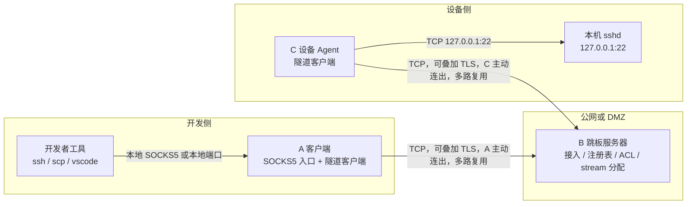
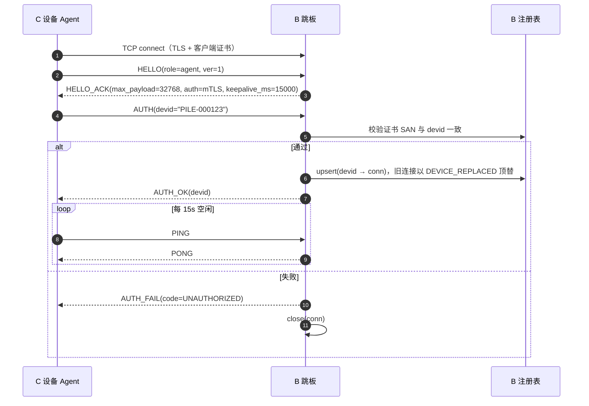
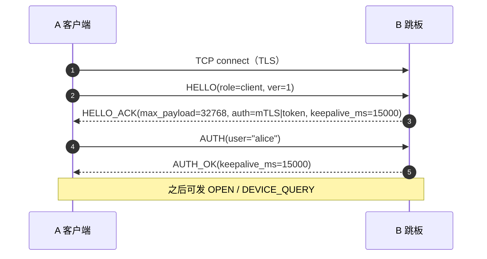
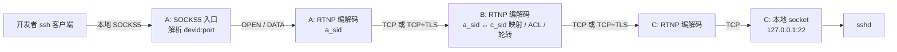
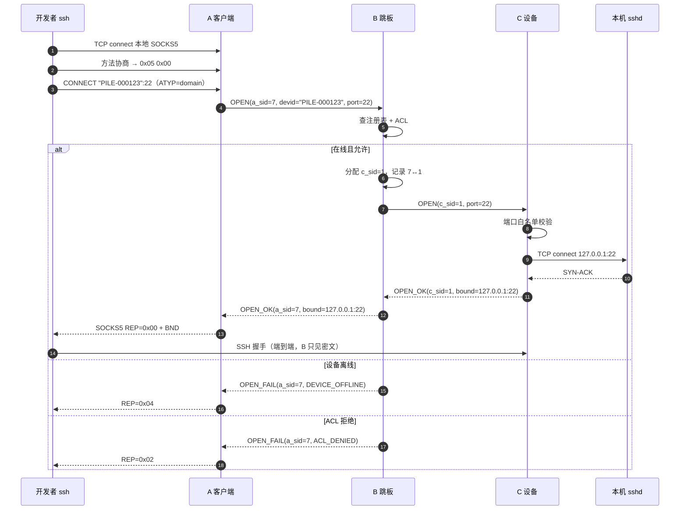
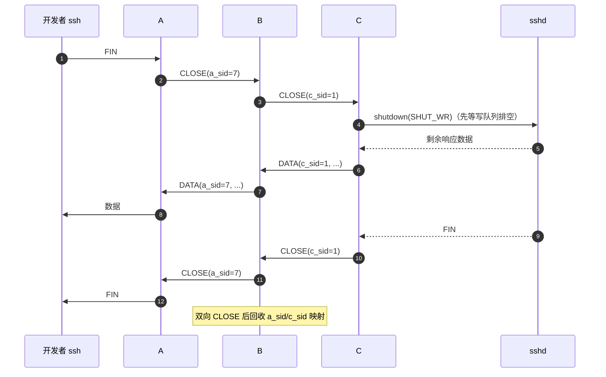

# 反向通道 rtunnel 设计（A → B → C）

> 拓扑/流程/时序/状态图（Mermaid + ASCII）与配置、状态、参数表见
> [`rtunnel-diagrams.md`](rtunnel-diagrams.md)。

> 一句话：设备与开发机都主动外连跳板，跳板按设备 ID 转发字节，形成一条**反向通道**。
> 承载范围：任意 TCP 应用——SSH / scp / HTTP / HTTPS / WebSocket / HTTP/2 / gRPC / 数据库协议等；
> 隧道不解析上层协议，只搬字节。不支持 UDP：HTTP/3、QUIC、DNS over UDP 都无法承载。

> 传输：A↔B、B↔C 均为 **TCP**（TLS 作为加密层，生产开启）
> 关联：`docs/cn/socks5.md`、`examples/socks5_proxy_server.c`、`event/socks5.c`

---

## 1. 目标与非目标

### 1.1 目标

- 开发者在自己的电脑（A）上，用标准 SSH 客户端访问任意在线设备（C）的本地 sshd。
- A 与 C 都**主动外连** B，不需要公网 IP、不需要端口映射。
- 一条 A↔B、一条 B↔C 的长连接承载**多路并发会话**，互不阻塞。
- 复用现有工具链：`ssh`、`scp`、`vscode remote`、`proxychains`、`curl`。

### 1.2 非目标（v1）

- 不做通用 VPN、不做 UDP 转发。
- 不支持从 C 访问设备内网其他主机（仅 `127.0.0.1`）。
- 不做设备发现/端口扫描。
- 不承担设备业务协议（OCPP 等）；本隧道是运维旁路。

---

## 2. 术语

| 术语 | 含义 |
|---|---|
| **A（Client）** | 开发者侧客户端。本地 SOCKS5 入口或端口映射，把流量塞进隧道 |
| **B（Relay）** | 跳板服务器。接入、设备注册表、鉴权、stream 分配与路由 |
| **C（Agent）** | 设备侧 agent。连 B、上报 devid、执行「连本地 sshd」并透传字节 |
| **devid** | 设备唯一标识，命名规则见 §8.5 |
| **a_sid / c_sid** | A↔B 段与 B↔C 段各自的 stream_id，由 B 映射（§10） |
| **a:\<user\>** | A 侧按需 agent 的 devid：shell 落在开发者机器上，而不是设备 |
| **admin** | B 上的管理台：HTTP API + WebSocket 终端 + Web 前端（`--admin-docroot` 或内嵌版） |
| **RTNP** | 反向通道协议（Reverse Tunnel Protocol），运行在 TCP 之上 |

---

## 3. 拓扑与角色

### 3.1 拓扑



- A 与 C 之间没有直接连接，各自与 B 建一条长连接，B 按 stream 转发字节。
- B 是唯一知道「哪些设备在线」的一方，也是唯一能做 ACL 的位置。
- SSH 是 A 上的客户端 ↔ C 的 sshd **端到端**；A/B/C 只搬字节，不解析 SSH。

### 3.2 角色边界

| 组件 | 职责 | 明确不做 |
|---|---|---|
| **A** | 本地 SOCKS5 入口；登录 B；把 `devid:port` 转成 OPEN；维护 a_sid；双向搬运；逐跳流控 | 不做 DNS；不解析 SSH；不接受 IP 形式目标 |
| **B** | 接入与认证；devid 注册表；ACL；**分配 c_sid**；双向 id 映射；帧转发与轮转调度 | 不解析业务协议；不做 SOCKS5；不改写 payload |
| **C** | 登录 B 并上报 devid；保活重连；执行 OPEN（固定 `127.0.0.1:port`）；端口白名单 | 不解析 SSH；不访问非回环地址 |

---

## 4. 关键设计决策

| 编号 | 决策 | 理由 |
|---|---|---|
| D1 | **SOCKS5 只在 A 一处出现**，B/C 不实现 SOCKS5 | 隧道内再套一层只多两次握手、多一层状态机，无收益 |
| D2 | A↔B、B↔C 各自**一条 TCP 长连接 + 多路复用** | NAT 友好；避免每条会话重复 TLS |
| D3 | 隧道协议自定义（RTNP），**不用 protobuf** | 帧头 16 B、控制字段极少；protobuf 只增加解析层与体积 |
| D4 | B **不解析 SSH/SOCKS5**，只按 stream 转字节 | 信任边界小、实现简单、吞吐高 |
| D5 | 设备身份与 devid **强绑定**（证书 SAN → devid），不信任客户端自报 | 否则任意设备可冒充 devid 劫持运维流量 |
| D6 | **stream_id 由 B 在 B→C 段统一分配** | 多条 A 连接汇聚到同一条 C 连接，A 自行分配必撞车 |
| D7 | 流控**逐跳**（A↔B、B↔C 各自独立 credit）+ **连接级在途上限** | 端到端 credit 约束不了中继写队列；libhv 的写缓冲是 per-connection 且超限直接关连接（`event/nio.c:533`） |
| D8 | devid 必须**非纯数字**，A 只接受 `ATYP=domain` | 纯数字会被 `inet_aton` 当 IPv4，客户端可能发 ATYP=IPv4，导致识别错乱 |
| D9 | 半关闭**自己实现**（`shutdown(SHUT_WR)`），不用 `hio_close_upstream` | libhv 的 upstream 关闭是双向的（`event/hevent.c:911`），会丢 ssh 收尾数据 |

---

## 5. 连接与会话生命周期

### 5.1 C 注册上线



同一 devid 重复上线：新连接替换旧连接，旧连接所有 stream 以 `DEVICE_REPLACED` 关闭。

### 5.2 A 登录



mTLS 模式下 user 以客户端证书 SAN 为准：AUTH.user 与 SAN 不符即拒绝（同 §5.1 设备侧）。

### 5.3 心跳与重连

- 空闲 15s 发 `PING`；连续 3 次无 `PONG` 判死。
- C 断线重连退避 `1,2,4,8,16,30s`（上限 30s，±20% 抖动）。
- A 重连期间本地 SOCKS5 仍监听，OPEN 直接失败。

---

## 6. 开发者接入方式

### 6.1 SOCKS5（推荐）

A 在 UDS `~/.rt/socks.sock`（默认）或 `127.0.0.1:1080` 提供 SOCKS5，**devid 就是 CONNECT 的目标地址**：

```
Dev: SOCKS5 CONNECT "PILE-000123":22   (ATYP=domain)
A  : devid=PILE-000123, port=22 → 发 OPEN
```

```sshconfig
Host PILE-000123
    HostName PILE-000123
    User root
    ProxyCommand ncat --unixsock ~/.rt/socks.sock --proxy-type socks5 --proxy %h:%p
    HostKeyAlias %h
```

> `ssh devid@localhost:port` 不成立：`devid@` 是 SSH 握手内的用户名，A 看不到；设备选择必须在 SOCKS5 目标地址（或本地端口）里。

### 6.2 每设备本地端口

`a-cli tunnel PILE-000123` → `127.0.0.1:16022`，开发者 `ssh -p 16022 root@127.0.0.1`。A 按「端口 → devid」映射发 OPEN，不需要 SOCKS5。同一 devid 复用同一端口，进程退出回收。

---

## 7. 数据面

### 7.1 字节路径



逐跳只做「解帧 → 查表 → 重新编码转发」，payload 原样透传。

### 7.2 建立会话



### 7.3 逐跳流控

每个跳的两个方向各自独立记 credit，**并且整条连接有一个在途上限**（D7）。

```
接收方：queued = 已收下但未写出的字节；granted = 已发出的 WINDOW 增量
        可补窗口 = initial_credit - queued - granted
发送方：credit = initial - 已发 DATA + 已收 WINDOW
        credit < max_frame → 暂停该 stream 的源读取
```

约束（不变量）：

1. `initial_credit ≥ low_water + max_frame`（防死锁）。
2. `Σ 各 stream 在途 ≤ conn_inflight_max`；达到上限时**停止对上游补 WINDOW**，而不是关连接。
3. `hio_set_max_write_bufsize()` 只是最后防线，取值 `conn_inflight_max + max_frame`；正常路径永不触碰（触碰即视为实现 bug）。
4. 收到 WINDOW 后校验 `credit + 增量 ≤ initial_credit`，越界按 `PROTOCOL_ERROR`。

参数：`max_frame = 32 KiB`、`initial_credit = 128 KiB`、`conn_inflight_max = 512 KiB`、`low_water = 64 KiB`、`high_water = 384 KiB`。

> 注意：`hio_write()` 返回成功只代表进了写队列，不代表对端消费；credit 只能按写队列降到低水位补。

### 7.4 帧调度

B 对同一连接按 **stream 轮转** 发送，不按到达顺序写满一个 stream；控制帧（PING/PONG/CLOSE/RESET）走优先队列，避免被大流量饿死。单帧 ≤ 32 KiB，把头阻塞延迟限制在一帧以内。**不保证带宽公平**：一条 scp 仍会占满链路，其他会话只是变慢不会断。

### 7.5 关闭与半关闭



- `CLOSE` = 本方向 EOF，**不是**立即销毁。
- 收到 CLOSE 后先 `hio_write_is_complete()`，再对本地 socket `shutdown(SHUT_WR)`，继续读另一方向。
- 双向 CLOSE 后 `hio_close()` 并回收 id；半关闭后 60s 未收到对端 CLOSE → `RESET(CLOSE_TIMEOUT)`。
- **不要用 `hio_close_upstream()`**：它会把两个方向一起关。

---

## 8. 自定义协议 RTNP v1

### 8.1 帧格式（16 字节头）

| 字段 | 长度 | 说明 |
|---|---|---|
| `magic` | 4 B | `0x52 0x54 0x4E 0x50`（"RTNP"） |
| `version` | 1 B | 固定 `1` |
| `type` | 1 B | 见 8.2 |
| `flags` | 2 B | v1 必须为 0 |
| `stream_id` | 4 B | `0` = 连接级；`1..2^32-1` = 会话流 |
| `length` | 2 B | payload 字节数，`≤ max_payload`（默认 32768） |
| `reserved` | 2 B | 必须为 0 |
| `payload` | n B | 按 `type` 解释 |

- 全部**大端**；字符串为 `u16 len + bytes`（无 NUL）。
- 协议版本由 `PROTO_VERSION` / `PROTO_MIN_VERSION` 定义（当前均为 1），帧头 `VERSION` 固定为 1；
  单帧 payload 上限为 `MAX_PAYLOAD = 32768`，由 `HELLO_ACK.max_payload` 协商。
- **未知 type**：`stream_id > 0` → 对该 stream `RESET(PROTOCOL_ERROR)`（跳过 DATA 会让字节流错位）；`stream_id == 0` → 关闭连接。
- `length > max_payload` 或 `reserved != 0` → 关闭连接。
- 前向兼容预留：`type` 最高位为 1 表示「可选扩展」，不认识的连接级扩展按 length 跳过；v1 不定义任何可选类型。

### 8.2 消息类型

**连接级（stream_id = 0）**

| type | 名称 | 方向 | payload |
|---|---|---|---|
| `0x01` | `HELLO` | 双向 | `u8 role`(1=C,2=A) + `u8 ver` + `str agent_ver` + `u32 capabilities` |
| `0x02` | `HELLO_ACK` | B→对端 | `u16 max_payload` + `u8 auth_methods`(bit0 mTLS,1 token) + `u32 keepalive_ms` + `u32 capabilities` |
| `0x03` | `AUTH` | 双向 | C：`str devid`；A：`str identity`（保留）+ `u8 auth_type`(0=none,1=`rtk-` 令牌,3=管理台内部代理) + `str token` |
| `0x04` | `AUTH_OK` | B→对端 | `str devid`（规范化）+ `u32 keepalive_ms` |
| `0x05` | `AUTH_FAIL` | B→对端 | `u16 code + str msg` |
| `0x06` | `PING` | 双向 | `u64 时间戳ms` |
| `0x07` | `PONG` | 双向 | 回显 |
| `0x08` | `DEVICE_QUERY` | A→B | `str devid`（仅 UI，§8.7） |
| `0x09` | `DEVICE_STATUS` | B→A | `str devid + u8 online + u32 active_streams` |
| `0x0F` | `ERROR` | 双向 | `u16 code + str msg`（非致命） |
| `0x18` | `SPAWN_AGENT` | B→A | `str devid`：要求 A 在本机按需拉起 agent（§12.1） |
| `0x19` | `SYSINFO_REQ` | B→C | 空：要求上报系统信息 |
| `0x1A` | `SYSINFO` | C→B | `str json`：运行时/系统快照 |
| `0x1B` | `CONFIG_SET` | B→C | `str json {ports?,shell?}`，sid 为请求号 |
| `0x1C` | `CONFIG_ACK` | C→B | `str json {ok,ports,shell,persisted}`，sid 回显 |
| `0x1D` | `FILE_BEGIN` | B→C | `str dir + str name + u64 size + str sha256`，sid=传输号 |
| `0x1E` | `FILE_DATA` | B→C | 原始字节（≤32KiB） |
| `0x1F` | `FILE_END` | B→C | `str sha256` |
| `0x20` | `FILE_ACK` | C→B | `str json {ok,received,error}` |
| `0x21` | `FILE_CHECK_REQ` | B→C | `str dir + str name` |
| `0x22` | `FILE_CHECK_ACK` | C→B | `str json {exists,size,sha256,error}` |
| `0x29` | `TTY_LIST_REQ` | B→C | 空：请求串口列表 |
| `0x2A` | `TTY_LIST_ACK` | C→B | `str json [{path,by_id}]` |
| `0x2B` | `TTY_CFG_SET` | B→C | `str json [{path,enabled,baud,data_bits,parity,stop_bits}]` |
| `0x2C` | `METRICS_CFG` | B→C | `str json` 采样配置 |
| `0x2D` | `METRICS_STATUS` | C→B | `str json {applied,error}` |
| `0x2E` | `METRICS_QUERY` | B→C | `str json {series,since_ts}`，sid 为请求号 |
| `0x2F` | `METRICS_DATA` | C→B | `str json {series,points,...}`，sid 回显 |
| `0x30` | `OTA_APPLY` | B→C | `str json {path,version,size,sha256}`，sid 为安装号 |
| `0x31` | `OTA_APPLY_ACK` | C→B | `str json {ok,phase,error}`（phase=verified\|installed） |
| `0x32` | `OTA_CANCEL` | B→C | 空：安装开始前取消 |
| `0x33` | `NET_REQ` | B→C | `str json {scope,proc,limit,refresh}`，sid 为请求号 |
| `0x34` | `NET_INFO` | C→B | `str json`：TCP/UDP/UNIX/IPC 快照，sid 回显 |
| `0x35` | `PROC_REQ` | B→C | `str json {op:list|detail|signal,...}`，sid 为请求号 |
| `0x36` | `PROC_INFO` | C→B | `str json`：进程列表/详情/信号结果，sid 回显 |
| `0x37` | `WARM_REQ` | B→C | `str json {ttl_ms}`：详情页打开期间续期，agent 每 30s 预热进程/服务缓存 |
| `0x38` | `POWER_REQ` | B→C | `str json {action:reboot\|poweroff,delay_ms,password}`，sid 为请求号；`password` 为设备 root 密码，仅透传不落日志 |
| `0x39` | `POWER_ACK` | C→B | `str json {ok,action,delay_ms,error}`，sid 回显 |
| `0x3A` | `DIAG_REQ` | B→C | `str json {max_mb}`，sid 为请求号 |
| `0x3B` | `DIAG_INFO` | C→B | `str json {ok,name,size,sha256,error}`，sid 回显 |
| `0x3C` | `DIAG_DATA` | C→B | 原始字节，按 32KiB 顺序分块，sid 回显 |
| `0x3D` | `DIAG_END` | C→B | `str json {ok,size,sha256,error}`，sid 回显 |
| `0x3E` | `STORAGE_REQ` | B→C | `str json {mount,path,depth}`，sid 为请求号；`path` 为子树根，`depth` 是相对该目录的回传层级 |
| `0x3F` | `STORAGE_INFO` | C→B | `str json {ok,mount,total_kb,used_kb,free_kb,reserved_kb,dirs,files,scan_ms,truncated,skipped,error}` |
| `0x40` | `STORAGE_DATA` | C→B | 原始字节：首字节 `\1` + gzip(整份响应 JSON)，按 32KiB 顺序分块；`\0` 表示未压缩明文 |
| `0x41` | `STORAGE_END` | C→B | `str json {ok,size,error}`，sid 回显 |
| `0x42` | `RELAY_LIST` | B→C | `str json {servers,rev,allow_leave}`：下发给 agent 的 relay 地址列表 |
| `0x43` | `RELAY_LIST_ACK` | C→B | `str json {ok,rev,count,current,switching,persisted,error}` |
| `0x44` | `EXEC_REQ` | B→C | `str json {argv,cwd,timeout_ms,max_bytes}`，sid 为请求号；argv 逐段匹配 `--allow-exec`，不经过 shell |
| `0x45` | `EXEC_DATA` | C→B | 每块 `u8 tag + u32 大端长度 + 数据`：tag `0`=stdout、`1`=stderr；按序拼接，sid 回显 |
| `0x46` | `EXEC_END` | C→B | `str json {ok,exit_code,signal,duration_ms,stdout_bytes,stderr_bytes,truncated,timed_out,error}` |

**会话级（stream_id > 0）**

| type | 名称 | 方向 | payload |
|---|---|---|---|
| `0x10` | `OPEN` | A→B / B→C | A→B：`str devid + u16 port`；B→C：`u16 port`（C 固定连 `127.0.0.1`）；`flags & 0x0001 = OPEN_SHELL`，`0x0002 = OPEN_TTY`（payload `str devid + str tty_path + u32 baud + u8 db/par/stop`，`0x0004` 只读监听 / `0x0008` 接管 / `0x0040` 只读打开），`0x0010 = OPEN_FS`，`0x0020 = OPEN_SVC` |
| `0x11` | `OPEN_OK` | C→B→A | `str bound_host + u16 bound_port` |
| `0x12` | `OPEN_FAIL` | C/B→A | `u16 code + str msg` |
| `0x13` | `DATA` | 双向 | 原始字节 |
| `0x14` | `WINDOW` | 双向 | `u32 credit 增量` |
| `0x15` | `CLOSE` | 双向 | 空（本方向 EOF） |
| `0x16` | `RESET` | 双向 | `u16 code`（立即中止并回收） |
| `0x17` | `RESIZE` | A→C | `u16 cols + u16 rows`（shell 终端尺寸） |

> v1 的 OPEN 没有 host 字段。将来要访问设备内网其他主机，用预留的 capacity 位协商（v1 未定义常量），并在 C 侧配主机白名单。

### 8.3 错误码

| code | 名称 | 含义 | SOCKS5 REP |
|---|---|---|---|
| 0 | `OK` | 成功 | `0x00` |
| 1 | `UNAUTHORIZED` | 认证失败 | `0x02` |
| 2 | `DEVICE_OFFLINE` | devid 不在线（含无权访问，避免枚举） | `0x04` |
| 3 | `TARGET_REFUSED` | 目标拒绝/不可达 | `0x05` |
| 4 | `TIMEOUT` | OPEN 超时 | `0x04` |
| 5 | `PROTOCOL_ERROR` | 帧/状态非法 | `0x01` |
| 6 | `LIMIT_EXCEEDED` | 超并发/超流控 | `0x01` |
| 7 | `ACL_DENIED` | 权限不足 | `0x02` |
| 8 | `DEVICE_REPLACED` | devid 被新连接顶替 | `0x04` |
| 9 | `TARGET_NOT_ALLOWED` | 设备侧端口白名单拒绝 | `0x02` |
| 10 | `CLOSE_TIMEOUT` | 半关闭等待超时 | — |
| 11 | `CANCELLED` | A 在 OPEN 完成前取消 | — |

### 8.4 状态机

连接与会话的状态迁移见 [`rtunnel-diagrams.md`](rtunnel-diagrams.md) 第 5 节
（Mermaid 与 ASCII 各一份），此处不再重复。

### 8.5 devid 命名规则

```
^[A-Za-z][A-Za-z0-9._-]{0,63}$
```

必须字母开头，**禁止纯数字**（避免被当成 IPv4）。多租户用 `tenant/devid`，tenant 同样满足该规则。A 的 SOCKS5 入口**只接受 `ATYP=domain`**，收到 IPv4/IPv6 回 `REP=0x08`。

### 8.6 十六进制样例

`OPEN(a_sid=7, devid="PILE-000123", port=22)`：

```
52 54 4E 50  01 10  00 00  00 00 00 07  00 0F  00 00     ← 16B 头
00 0B 50 49 4C 45 2D 30 30 30 31 32 33 00 16             ← payload: len=11 + devid + port=22
```

B→C 同会话（c_sid=1）：`52 54 4E 50 01 10 00 00 00 00 00 01 00 02 00 00 00 16`。

### 8.7 DEVICE_QUERY 的定位

仅用于 UI（设备列表、自动补全）。数据面**永远以 OPEN 结果为准**（查询与 OPEN 之间有竞态）。对无权限的 devid 一律返回 `online=0`，不泄露存在性。

### 8.8 超时

| 参数 | 默认 |
|---|---|
| 握手超时 | 5 s |
| 认证超时 | 10 s |
| OPEN 超时（C 本地 connect 独立 5 s） | 15 s |
| 半关闭超时 | 60 s |
| 关闭超时 | 10 s |
| 心跳间隔 / 失败阈值 | 15 s / 3 |

---

## 9. SOCKS5 与 OPEN 的映射

| SOCKS5 事件（A 侧） | 隧道动作 | 回给客户端 |
|---|---|---|
| `CONNECT devid:port`（ATYP=domain） | `OPEN(a_sid, devid, port)` | `OPEN_OK` → `REP=0x00` + BND |
| ATYP=IPv4/IPv6 | 拒绝 | `REP=0x08` |
| 设备离线 / 无权 | — | `REP=0x04` |
| 目标拒绝 | — | `REP=0x05` |
| ACL / 端口白名单拒绝 | — | `REP=0x02` |
| OPEN 超时 | — | `REP=0x04` |
| 客户端在 OPEN 前断开 | `RESET(a_sid, CANCELLED)` | — |
| `BIND` / `UDP ASSOCIATE` | 不支持 | `REP=0x07` |

> A 的 SOCKS5 入口不能直接用 `hloop_create_socks5_proxy_server()`：它会在本地直接 connect 目标（`event/socks5.c:392`，实际连接在 `socks5_server_connect()`，`event/socks5.c:86`），而 `devid` 不是域名。需复用手握状态机骨架，把 CONNECT 分支换成「发 OPEN + 等结果」。

---

## 10. B 的路由与 id 分配

```
registry: map<devid, AgentConn>
AgentConn  { conn_id, remote_ip, tls_fingerprint, streams: map<c_sid, ...>, last_seen }
ClientConn { conn_id, user, streams: map<a_sid, ...> }
StreamMeta { a_conn_id, a_sid, c_conn_id, c_sid, state, opened_at }
```

- `a_sid` 由 A 分配，**单条 A-B 连接内唯一、单次使用**；重复即 `OPEN_FAIL(PROTOCOL_ERROR)`。
- `c_sid` 由 **B** 在目标 C 连接上分配（单次使用），并建立双向映射。
- 回程帧（`OPEN_OK/FAIL/DATA/WINDOW/CLOSE/RESET`）到 B 后按反向表把 `c_sid` 换成 `a_sid` 再发 A。
- `CLOSE/RESET/超时` 释放两个 id 与映射。
- **单写者**：每连接一个写队列，帧串行写出，禁止多线程交错（避免半帧）。
- **ACL 检查点**：只在 OPEN 时做；ACL 变更不影响已建立会话。

---

## 11. 失败语义

| 场景 | 行为 |
|---|---|
| C 断线 | B 摘除 devid，该设备所有 stream 向 A 发 `RESET(DEVICE_OFFLINE)` |
| C 重连 | 重新注册；旧会话不恢复（SSH 自行重连） |
| 同 devid 重复上线 | 新连接顶替，旧 stream 全部 `RESET(DEVICE_REPLACED)` |
| A 断线 | B 回收该 A 所有 stream，通知 C `RESET` 并关本地 socket |
| B 重启 | A/C 退避重连，注册表重建 |
| OPEN 竞态 | 以 `OPEN_OK/OPEN_FAIL` 为准 |
| 半开连接 | 心跳 3 次丢失断开 |
| 关闭卡住 | DRAINING 10s / 半关闭 60s 强制回收 |
| 帧错误 | 流级 → `RESET`；连接级 → 关闭连接 |
| 连接在途超限 | 停止补窗口（正常背压）；若对端仍发送超 credit 数据 → `RESET(LIMIT_EXCEEDED)` |

---

## 12. 安全边界

- **信任模型**：B 是可信中继，TLS 在 B 终结；SSH 仍是 A↔C 端到端加密，B 只见密文与元数据。
- **设备身份**：mTLS，devid 取自证书 SAN；`AUTH.devid` 只是断言，与 SAN 不符即 `AUTH_FAIL`。
- **开发者身份**：A 只能用管理台签发的 `rtk-` 接入令牌，身份由令牌决定（`identity` 字段
  不参与认证）；mTLS 开启时再叠加证书 SAN 校验。`atk-` 只用于管理台 HTTP 接口。
- **设备授权**：按权限组（资源键 + 设备范围 + 端口范围）判断，未分组等于无权限；
  管理台内部代理使用进程内随机密钥（`auth_type=3`）连本机 relay，不落盘、不可配置。
- **授予边界**：权限管理本身也受权限约束，不能靠改权限提权。
  - 资源分为 `group.read`（查看组/成员/授权对象）、`group.write`（改组定义：资源、设备、端口）、
    `group.member`（改成员、给主体换组）；三者内置管理员组都有，受限账号要靠权限组显式授予。
  - 任何新建/修改组、给主体换组、删除组的请求，服务端都要求目标组的资源、设备、端口是
    操作者**有效权限的子集**；`super` 组只有 `super` 能改。前端只是隐藏按钮，判定在服务端。
  - 组的端口范围用区间覆盖判断（`*` 覆盖全部），令牌自带权限组时账号与令牌的端口取交集。
  - 账号没有角色回落：`permScopeOfUser` 只读 `perm_group_members`。`users.role` 只决定新建
    账号加入哪个内置组、以及账号管理页的层级；改角色会替换内置组成员（自定义组保留），
    组成员变化也会把 role 同步成最高的内置组，没有内置组时归 viewer。
    老库升级时 `perm_explicit=0` 的账号按角色补进内置组，然后删除该列；无组的 admin 也会
    补进超级组。超级组必须至少保留一个账号成员，内置角色组不能删除。
  - 令牌（atk / rtk）第一次绑定权限组就记为「显式」：此后组为空表示**无权限**，不再回落到
    归属账号；清空自己的组不会恢复账号权限，修改令牌组同样校验目标有效范围。换组接口、
    组页面保存、删除组三个入口都会维持这个标记，撤销不会变成提权。
  - 资源分「设备级」与「全局」两类：`repo.*`、`relay.*`、`dict.*`、`group.*`、`account.*`、
    `token.*`、`cert.*`、`audit.read`、`settings.*`、`system.shutdown` 是全局键。全局键需要
    权限组开启 `global_scope`（勾了「全部设备」或 `super` 自动视为开启）；受限组即使持有这些键
    也不生效，避免通过全局键影响范围外的设备。`global_scope` 是授予边界的一部分：没有全局权限
    的账号不能授予全局键，也不能修改带全局权限的组或主体；组里含全局键但未开启全局权限会被拒绝，
    不会静默失效。内置角色组默认开启，保留传统角色语义。
    仓库与设备文件拆开：`repo.read/write/delete` 管 relay 本机仓库，`file.read/write` 管设备文件；
    「部署到设备」同时需要 `repo.read` 和 `file.write`。
  - 给主体换组、改组成员、组页面保存与删除组时，目标**当前**有效权限也必须是操作者权限的
    子集，避免委托管理员通过清空同级账号的组来停用对方，或把更高权限的令牌“关进”窄组。
  - 接入账号的管理接口（改/删/踢账号，签发/改/轮换/删令牌）同样校验**归属账号**当前权限在
    操作者范围内：令牌继承账号权限，能轮换就等于能拿到该账号的明文令牌，不能只看 `account.write`。
  - 启停设备资源（`PUT /permission/devices/:devid`）要求该设备在操作者范围内：停用会让所有
    非 super 组失去这台设备。改账号时未显式传 `status` 保持原状态，不会把停用账号放回来。
    被移出组、组被删除的成员按主体逐个断开（atk 断管理台 WS、rtk 断数据面连接）。
    内置角色组可以编辑资源与设备范围（同样受这条授予边界约束），但不能删除。
  - `/device/:devid/:port/*` 等价于一次端口转发：要求 `device.port` 且端口在自己的范围内，
    不再借用 `device.terminal`。
  - 管理台用户名限制为 1–64 字符、不含控制字符、首尾不能是空格（中间允许）；密码至少 8 位。
  - 管理台 WebSocket 的 `Origin` 按 `scheme://authority` 与 `Host` 精确比对，不再做子串匹配。
  - 资源键到数据面能力只有一处映射（`capsForScope`）：`device.port` → TCP 端口范围，
    `device.terminal` → shell，`device.tty.read` → 只读串口，`device.tty.write` → 写串口/接管，
    `file.read/write` → 文件只读/读写，`device.svc` → 服务管理。`device.view` 只控制可见性，
    不再隐含服务启停；串口只读用户打开的是 `O_RDONLY` 流，写方向在 agent 侧丢弃。
- **撤权即时性**：令牌吊销/轮换、账号停用/删除、权限组变更都会让 relay 关闭该主体的
  已建立连接（含其下所有流），客户端必须重新认证；新流在 `OPEN` 时按当前规则重新判定。
  管理台自己的 WebSocket（终端/串口/文件/服务/设备代理）同样登记了所属账号与 atk 令牌：
  账号停用/删除、改密、角色变更、令牌停用/轮换/吊销立即断开；权限组或授权对象变更时
  只断开**有效权限变小**的账号（扩容、改名不打断），页面需重新握手。
- **审计**：管理动作记录真实操作者（用户名`#id`、atk/rtk 令牌 id、角色、来源 IP），
  不再只记录角色；页面「系统 → 审计」按 `actor` 展示。
- **目标限制**：C 只连 `127.0.0.1`，端口白名单默认仅 22。
- **入口暴露**：A 的 SOCKS5 默认走 UDS（0600）；用 TCP 时仅绑回环。

---

## 12.1 A 侧按需 agent（a:<user>）

开发者机器的 shell 不常驻：

1. admin 以内部代理身份对 `a:<user>` 发 `OPEN_SHELL`；
2. B 未命中注册表且 devid 形如 `a:<user>`、该 user 的 client 在线 → 下发 `SPAWN_AGENT`，
   挂起 OPEN（10s 超时，超时回 `OPEN_FAIL(TIMEOUT)`）；
3. A 校验 `devid == "a:" + 自身 user` 且开了 `--allow-shell`，在本机 fork/exec
   `rtunnel-agent --devid a:<user> --allow-shell --max-idle N`；
4. agent 以 `a:<user>` 注册上线，B 继续挂起的 OPEN；空闲 N 秒后 agent 自退，A 退出时回收。

**为什么不在 A-B 连接上叠双角色**：一条连接只有单一 role/identity/stream 命名空间，
双角色需要两套身份、两张流表、两套 sid，且 A 的连接会变成 relay 随时可执行命令的入口；
拆成独立 agent 进程后，身份（user 与 a:user）、授权（`device.terminal`）、生命周期（按需起停）、
故障域都彼此独立，shell 逻辑与设备 agent 完全复用。

## 13. 管理台与运维面

B 内置管理台（libhv HttpService + WebSocket），**独立 worker 线程**，relay 状态经
`hloop_post_event` 回投到 relay 线程，数据面不加锁。

### 13.1 启停与鉴权

| 参数 | 说明 |
|---|---|
| `--admin ADDR` | 监听地址，如 `127.0.0.1:9443`；启动时不带凭据且非回环会被拒绝 |
| `--admin-token T` | 首次初始化 admin 用；初始化完成后仅作紧急入口（仍只放行 setup） |
| `--admin-docroot D` | 前端静态目录，指向 `web/dist`；未指定且非内嵌版时管理台页面不可用 |
| `--admin-ca-cert/--admin-ca-key/--admin-cert-dir` | 签发 CA 与台账目录 |
| `--admin-file-dir D` | 文件管理根目录 |
| `--admin-db PATH` | SQLite 库：管理台账号、会话、设备、权限分组、接入账号/Token、API Token；需 OpenSSL 构建（PBKDF2） |

账号体系：首次用 `--admin-token` 初始化 admin，之后用户名+密码登录（HttpOnly Cookie 会话）。
角色只是内置权限组的别名：新建账号自动加入 admin/manager/operator/viewer 对应的内置组，
之后权限只按组求值；改角色会替换内置组成员。角色还决定账号管理页的层级（不能操作比自己高的
角色）。
口令 PBKDF2-HMAC-SHA256；失败锁定与会话时长可配置（默认 5 次/5 分钟、12h）；改密/禁用吊销会话。

### 13.2 系统信息与能力配置

- `SYSINFO_REQ(0x19)` / `SYSINFO(0x1A, str json)`：B 按需请求，C 返回运行时/系统快照；
- `NET_REQ(0x33, str json {scope,proc,limit})` / `NET_INFO(0x34, str json)`：B 按需请求
  网络与 IPC 快照，C 在后台线程采集后回帧（sid 回显请求号）；
  relay 仅内存缓存，详情页打开时刷新一次，不周期上报
- 快照字段：version/args/caps、uname/CPU/内存/分区/负载/网卡、证书（mTLS 未配置则 `mtls=false`）
- `CONFIG_SET(0x1B)` / `CONFIG_ACK(0x1C, sid 回显)`：在线修改 `ports` 与 `shell`；
  agent 校验→原子替换→写 `--config-file`（默认 `/opt/data/etc/rtunnel-agent.json`）→ ACK
- `PUT /api/v1/agents/{devid}/caps`：按字段鉴权，端口/串口/OTA 分别要求
  `device.caps.write` / `device.tty.write` / `device.ota.write`；离线返回 404

### 13.3 接口

| 方法 | 路径 | 说明 |
|---|---|---|
| GET | `/api/v1/overview` | 汇总（agents/clients/streams/bytes/version） |
| GET | `/api/v1/agents`、`/api/v1/agents/{devid}` | 设备列表/详情 |
| GET | `/api/v1/agents/{devid}/{sysinfo,ttys,metrics/series}` | 设备运行信息、串口、指标 |
| GET | `/api/v1/agents/{devid}/net` | 网络与 IPC 快照（scope/proc/limit/refresh） |
| GET | `/api/v1/agents/{devid}/procs[/{pid}]` | 进程列表与详情 |
| POST | `/api/v1/agents/{devid}/procs/signal` | 结束进程 / 发送信号 |
| POST | `/api/v1/agents/{devid}/exec` | 执行白名单内的命令（argv，不经过 shell），见 §13.13 |
| POST | `/api/v1/operations/plan`、`/{id}/apply`、`/{id}/verify` | 操作作业三阶段，见 §13.13 |
| GET | `/api/v1/operations` | 作业列表（按 devid / limit） |
| PUT | `/api/v1/agents/{devid}/caps` | 在线改端口/Shell/串口/OTA 开关（按字段校验资源键） |
| POST | `/api/v1/agents/{devid}/kick` | 强制设备下线（agent 自动重连） |
| GET | `/api/v1/clients`、`/api/v1/streams` | 客户端与流列表 |
| DELETE | `/api/v1/streams/{a_sid}` | 踢单个会话（双侧 RESET） |
| GET | `/api/v1/devices`、`PUT /api/v1/devices/{devid}/owner` | 设备归属 |
| GET/POST/PUT/DELETE | `/api/v1/permission/groups[/{id}]` | 权限组（资源/设备/成员） |
| GET/PUT | `/api/v1/permission/groups/{id}/members` | 权限组成员 |
| GET | `/api/v1/permission/resources`、`PUT /permission/resources/{key}` | 功能资源字典 |
| GET | `/api/v1/permission/subjects`、`GET/PUT /permission/subjects/{type}/{id}/groups` | 授权对象与权限组绑定 |
| GET | `/api/v1/permission/dicts?kind=resources|devices|ports|ttys` | 四类字典分页 |
| GET/POST/PUT/DELETE | `/api/v1/permission/dict/{ports,ttys}[/{id}]` | 端口/串口字典、批量新增与删除 |
| PUT | `/api/v1/permission/devices/{devid}` | 设备资源改名/停用/换租户 |
| GET/POST/PUT/DELETE | `/api/v1/client-accounts[/{id}]` | 接入账号（带 `tenant_id`）；含 `/effective`、`/{id}/tokens` |
| PUT/POST/DELETE | `/api/v1/client-tokens/{id}`、`/rotate` | Token 限额、启停、轮换、吊销 |
| GET/POST/PUT/DELETE | `/api/v1/admin-tokens[/{id}]`、`/{id}/rotate` | 管理台 API Token；manager 管自己的，admin 管全部，Token 不能管理 Token |
| GET/POST/PUT/DELETE | `/api/v1/users[/{id}]` | 管理台账号、角色、状态、密码、权限组 |
| GET/PUT | `/api/v1/settings` | 运行参数（上传上限、会话、锁定时长等） |
| GET/POST | `/api/v1/distributions[/{id}]` | 文件分发任务与重试/取消/延长/校验 |
| GET | `/api/v1/audit` | 审计（登录、OPEN、踢、证书、文件、终端、权限变更） |
| GET | `/api/v1/events` | SSE 事件流（设备/会话/审计/告警/任务），支持 Last-Event-ID，见 §13.14 |
| GET/POST/PUT/DELETE | `/api/v1/playbooks[/{id}]`、`/{id}/run`、`/fires` | 自愈规则与触发记录，见 §13.16 |
| GET | `/api/v1/agents/{devid}/metrics/history` | 分钟级指标（cpu/内存/负载/网卡），见 §13.14 |
| GET | `/api/v1/usage` | 用量报表（日聚合）：流量/会话/设备在线，可按 `tenant_id` 过滤，见 §13.10 |
| GET/POST/PUT | `/api/v1/tenants[/{id}]` | 租户列表/新建/改名启停，见 §13.11 |
| GET/PUT | `/api/v1/billing/prices[/{metric}]`、`/billing/summary` | 价目与费用试算，见 §13.12 |
| GET/POST/PUT | `/api/v1/billing/statements[/{id}]`、`/{id}/csv` | 账期结算单与导出，见 §13.12 |
| GET/POST | `/api/v1/certs`、`/api/v1/certs/issue`、`/sign`、`/revoke` | 证书台账/签发/CSR 签名/吊销（admin） |
| GET/POST/DELETE/PUT | `/api/v1/files[/{name}]` | 文件列表/上传/下载/删除/原子编辑（编辑需 manager+，上限可配置，默认 32 MiB；文件名白名单） |
| GET | `/api/v1/uploads/{name}` | 分片上传状态与续传 |
| GET/POST | `/api/v1/alerts/status`、`/api/v1/alerts/test` | 告警发送结果与测试 |
| GET | `/metrics` | Prometheus 文本指标 |
| WS | `/ws/shell?devid=..`、`/ws/tty/{devid}/{alias}` | 浏览器终端、串口调试（会话 Cookie） |
| WS | `/ws/fs/{devid}`、`/ws/svc/{devid}` | 设备文件/服务通道；浏览器用会话 Cookie，脚本用 `Authorization: Bearer` |
| POST | `/api/v1/shutdown` | 优雅退出 |

### 13.4 Web 终端

- 身份固定为管理台内部代理（进程内密钥，`auth_type=3`），浏览器**不能**指定用户（防冒充）；
- 设备列表 → `devid`；客户端列表 → `a:<user>`（触发 §12.1 按需 agent）；
- 操作者需有 `device.terminal` 且设备在其范围内；目标 agent 需开 `--allow-shell`；
- 输入/输出走 `DATA`，尺寸走 `RESIZE`；
- 管理台是 **HTTP 明文**：非回环部署建议加 TLS 反代或只绑回环。

### 13.5 设备 Web 代理

`/device/<devid>/<port>/<path>`：admin 用会话身份做一次 `OPEN(devid, port)`，把 HTTP/WS 双向转发。

- 鉴权：Cookie 会话 + `device.port` 资源 + 设备归属 + 端口在自己的范围内（等价一次端口转发）
- HTTP：响应头到达即 `EndHeaders(chunked)`，DATA 帧边收边写；上游 chunked 增量解码
- WS：向设备做二次握手（不协商压缩扩展），浏览器帧 ↔ RTNP DATA 双向封装
- Cookie：`d_<devid>_<port>_` 前缀隔离，避免与管理台及其他设备串味
- 上限：32 并发；HEAD/204/304 无响应体；不支持设备 HTTPS

### 13.6 文件分发任务

**数据表**

```sql
distribution_tasks(
  id, batch_id, devid, file_name, file_size, file_sha, sub_dir, target_path,
  status, start_at_ms, deadline_at_ms, retry_count, max_retries, next_retry_ms,
  extend_count, sent, error, relay_tid, actor, created_ms, started_ms, finished_ms
);
file_meta(name, size, mtime_ms, sha256);
```

**状态**

```
scheduled → queued → running → success
                       ├─ 失败且 retry < max → queued（30/60/120s）
                       ├─ 重试耗尽 → failed
                       └─ 超过截止 → timeout（可延长一次，≤+24h）
queued/scheduled → canceled
创建时同 devid + 同 sha 已有 success/conflict → conflict
```

**接口**

| 方法 | 路径 | 说明 |
|---|---|---|
| POST | `/api/v1/distributions` | `{file,dir,devids,start_at_ms,deadline_at_ms,max_retries}` |
| GET | `/api/v1/distributions` | `status/q/batch/page/per_page` |
| GET | `/api/v1/distributions/summary` | 全部/进行中/已完成/失败/冲突计数 |
| GET | `/api/v1/distributions/{id}` | 详情 |
| POST | `/{id}/retry` | 失败任务重试（截止前） |
| POST | `/{id}/cancel` | scheduled/queued 取消 |
| POST | `/{id}/extend` | timeout 延长一次 |
| POST | `/{id}/verify` | 校验设备文件哈希，相同→success，不同→queued |
| POST | `/{id}/force` | 同 verify |

**调度**

- 1s 轮询 DB，全局并发 3，同设备串行
- `start_at` 前只排队；`deadline_at` 未完成标 timeout 并取消 relay 传输
- 文件大小/哈希在创建时写入任务；执行前文件被替换会校验失败
- 上传完成计算并缓存 sha256，文件列表显示前 8 位

### 13.7 文件与服务管理

设备文件与服务管理复用同一条 RTNP 数据通道，relay 只转发，不解析应用层协议：

| 能力 | 打开帧 | 设备侧 | 管理台路由 | 本地页路由 |
|---|---|---|---|---|
| 文件管理 | `OPEN_FS(0x10)`，payload `u8 want_rw + u8 trusted` | `agent/fs_session.*` + `fs_service.*`，根目录 `--file-root` | `/ws/fs/{devid}` | `/ws/fs` |
| 服务管理 | `OPEN_SVC(0x20)`，payload `u8 trusted` | `agent/svc_session.*` + `svc_service.*`（systemctl/journalctl） | `/ws/svc/{devid}` | `/ws/svc` |

- 前端是 `shared/web/fs-ui.js` / `svc-ui.js`，本地页由 CMake 嵌进二进制，
  管理台直接 import 同一份文件；`shared/web/file-view.js` 提供 Hex/尾部只读查看器
- 文件协议：文本帧 JSON 控制消息 + 16 字节头二进制数据帧，下载/上传按 30 KiB 分块，
  上传写 `.rtunnel-upload/<id>.part` 后 `fsync + rename`；路径限制在 `--file-root` 内
- 服务协议：JSON `hello/list/logs/action`；所有 systemctl/journalctl 在 agent 工作线程执行，
  列表缓存 10 秒；默认只读，`--svc-rw` 才允许控制
- 管理台走本机 relay 打开通道，使用进程内代理密钥认证（不落盘、不配置）；
  操作者权限（`file.read/write`、`device.terminal`）与设备范围在管理台侧校验

### 13.8 管理台前端

前端是独立的 Vite + Vue 3 + Element Plus 工程：`relay/admin/web`，构建产物在 `web/dist`。
两种交付方式，源码只有一份：

| 方式 | 构建 | 运行时 |
|---|---|---|
| 磁盘目录（默认） | `npm run build` | `--admin-docroot web/dist`；不传则页面 404，仅 API 可用 |
| 内嵌（发布） | `-DRTUNNEL_ADMIN_WEB=ON` 后 `--target rtunnel-relay-embedded` | 无需 docroot，单二进制自带前端 |

- 内嵌是独立 target，默认不构建：`rtunnel-relay` 仍是不带前端的小二进制，
  日常开发用 docroot 热改，发布用内嵌版，避免“换了 relay 忘了换 admin/web”的版本错配
- 构建期由 `rtunnel/cmake/gen_admin_web.cmake` 遍历 `web/dist`，优先嵌 `.gz` 预压缩体，
  生成 `{ 路径, 数据, 长度, 是否 gzip, Content-Type }` 表；
  `web/dist` 任一文件变化都会重跑生成
- 运行优先磁盘：`--admin-docroot` 命中的文件按磁盘返回，磁盘没有（或没配）再回退内嵌；
  根路径先在磁盘里找 `admin.html`/`index.html`，两个都没有才查内嵌，避免内嵌 `admin.html`
  盖掉磁盘 `index.html`
- 客户端不支持 gzip 时首次访问解压一份并缓存；`/assets/*` 仍加长缓存头

```
relay/admin/web/src
├── pages/           每个路由一个页面（概览/设备/权限组/文件/分发/Token/文档/设置…）
├── components/      FileManagerCard、SvcManagerCard、ApiDocPanel 等
├── layout/          AppLayout：侧栏分组 + 顶栏
└── shared/          api/store/nav/utils/api-docs
```

- 路由使用 hash history（`#/overview`），`router.beforeEach` 先 `ensureBoot()` 再按
  `nav.canVisit()` 做角色守卫；侧栏与守卫共用 `shared/nav.js` 的 `NAV_GROUPS`
- 侧栏 5 组可折叠，默认只展开当前页所在组，空组自动隐藏
- `shared/api-docs.js` 是 `/docs` 页面与 Token「用法」抽屉的唯一数据源，
  `npm run check:docs` 与 `admin_routes.cpp` 对表
- 构建：`cd relay/admin/web && npm install && npm run build`
  （先构建 CodeMirror 编辑器 bundle，再构建页面并预压缩）

### 13.9 中继地址列表与同步任务

relay 在 agent `AUTH_OK` 之后、以及同步任务下发时发送 `RELAY_LIST`：

```json
{"servers":"r1.example.com:8443,r2.example.com:8443","rev":2957691368,"allow_leave":false}
```

- `servers` 与 `--server` 同语法（逗号分隔，最多 8 个，可省端口用 agent 默认端口）；
  顺序即优先级，第 0 个最高
- agent 首次连接和每次断线重连都从优先级最高的地址开始尝试；连不上/握手失败/认证失败的
  地址进入 30s 冷却，冷却期内跳过；没有可用地址时挑冷却最早到期的一个继续探测。
  已建立的连接不会被更高优先级地址抢占，重新排序在下次重连时生效
- `rev` 是 `servers` 与 `allow_leave` 的 32 位内容哈希，只用于对齐，agent 不比较大小
- 新列表不含 agent 当前连接的 relay 时，只有 `allow_leave=true` 才切换，否则回
  `{ok:false,error:"current relay ... not in list"}` 并保留原列表
- 接受后写入 agent 配置（`relay_servers` / `relay_servers_rev`），重启仍生效；
  `--server` 在启动时补在列表末尾兜底，不落盘
- `switching=true` 表示 agent 会延迟 200ms（先发 ACK）断开并按新列表第 0 个地址
  （最高优先级）重连
- agent < 1.4.98 不识别该帧；同步任务把这类设备直接判失败，不会一直等 ACK
- relay 每 5s 巡检 agent 控制连接，连续 60s 无帧即断开并标记离线；agent 每 15s 发 PING，
  整机失联不会长期停留在「在线」，断线同时清掉该设备的 ACK

管理台数据模型：

- `relay_dict` 地址字典（host/port + 名称/备注/启停），`relay_list` 存有序引用，
  `position` 即优先级（0 最高）；保存列表只更新期望状态，不主动推送
- 列表是全局的，不提供逐设备指派：要让设备换 relay，只能把当前 relay 移出列表并开启
  `allow_leave`，这会影响所有仍连在那台 relay 上的设备；逐设备迁移需要额外的设备级覆盖表
- 主动下发走同步任务：任务快照当前列表（`list_json` + `list_rev` + `allow_leave`），
  逐设备行复用 `distribution_tasks`（`kind='relay'`），支持定时开始、分批灰度、
  失败率闸门、暂停/继续/取消/重试
- 逐设备以 ACK 的 `rev` 对齐：`rev` 相同且 `ok=true` 记成功；离线设备保持 `pending`。
  `AUTH_OK` 下发的是**当前**列表，因此只有当前 rev 仍等于任务快照时该行才收敛；
  保存新列表会自动暂停快照过期的任务，恢复时校验 rev，不一致只能取消重建
- 收尾时 `pending` 不算成功：无失败但仍有待上线设备记为 `partial`；截止时间到时
  未完成的行统一取消，任务记 `failed`
- 取消会把已发出的 `running` 行一并置为 `cancelled`；暂停期间不释放、不补发，
  恢复后继续当前批次，下一批由调度器按批间隔释放

### 13.9.1 部署：从管理台把组件装到内网主机

目标：设备/中继接入前的那一步不该只能手工敲命令。运维在「运维 → 部署」登记目标主机的
SSH 地址与凭据，平台直接连过去装 agent/relay/client。

实现要点：

- **SSH 用 libssh2，不再调用外部 ssh/scp**：`relay/admin/backend/deploy_ssh.cpp` 封装连接、
  密码/私钥认证、命令执行、SFTP 上传，`3rd/libssh2` 是裁剪后的 1.11.1（OpenSSL 后端）。
  好处是 relay 主机不需要装 ssh 客户端/sshpass，也不需要目标机预装 agent；密码认证不依赖
  `SSH_ASKPASS` 这类 tty 技巧，sudo 密码直接写进通道 stdin（`sudo -S`）。
- **主机密钥 accept-new**：首次连接把 `sha256:<base64>` 记到 `<admin.db 同目录>/deploy/known_hosts`，
  之后指纹不一致直接拒绝，提示删掉对应行（防中间人）。
- **凭据不入库**：密码与私钥在 `<admin.db 同目录>/deploy/<host_id>.secret|.key`（0600），
  `deploy_hosts.secret_set` 只表示有没有存过；所有接口只回 `secret_set`。
- **作业模型**：`deploy_hosts` + `deploy_jobs`。一台主机同时只允许一个未结束作业；
  作业在后台 worker 里执行，逐步写 `step` 与 `log`（保留尾部 128KB），页面轮询
  `/api/v1/deploy/jobs/:id` 出实时日志；取消只置标志，SSH 读循环看到后断开通道。
- **步骤**：预检（连通性、`uname -m` 与包架构比对、是否 root、有无 systemd）→ SFTP 传包到
  `/tmp/rtunnel-deploy-<id>` → `tar --strip-components=1` 解包 → 写配置（agent 的
  `/opt/data/etc/rtunnel-agent.args`、relay 的 `/etc/rtunnel/relay.env`、client 的
  `/etc/rtunnel/client.env`，都在 `install.sh --start` 之前）→ 执行包内 `install.sh` →
  验证（版本、`systemctl is-active`、relay 额外探 `https://127.0.0.1:<admin>/`）→ 清理临时目录。
- **参数由服务端校验后再拼命令**：主机/用户名/设备 ID 限 `[A-Za-z0-9._-]`，安装目录必须是
  绝对路径且不含 `..`，端口白名单只允许数字和逗号；远端 shell 串一律单引号包裹，避免命令注入。
- **只装文件**：`no_units=true` 走 `install.sh --no-units` 且不传 `--start`，用于容器/临时前缀；
  验证只比对版本，不要求服务在跑。
- **安装包来源是文件仓库**：直接用 `packages/<component>/<version>/<arch>/` 下的包，
  和 OTA 分发同一份，不另建 `deploy/` 包目录。列表接口递归扫 `packages/`，按
  `rtunnel-<component>[-<variant>]-<version>-<arch>.tar.gz` 解析组件/版本/架构，回 `path`
  （如 `packages/agent/1.4.156/x86_64/…tar.gz`），创建作业时把 `path` 当 `package` 传；
  只接受列表里存在的包，仓库外的路径和 `..` 一律拒绝。页面上的「上传安装包」复用
  `/api/v1/files` 的分片协议，但落点按包名自动建成 `packages/<组件>/<版本>/<架构>/`
  （目录不存在就逐级创建），只需要 `deploy.write`，上传完 OTA 也能直接用。
- **网段扫描**（`POST /api/v1/deploy/scan`，`relay/admin/backend/deploy_scan.cpp`）：登记主机前
  先找出网段里开着 SSH 的机器，扫到的地址直接带进登记表单。relay 上装了 nmap 就用
  `nmap -Pn -n -p<port> --open -T4 --max-retries 1 --host-timeout 4s -oG -`（`-Pn` 避免屏蔽 ICMP
  的主机被漏掉；`-n` 不反解 DNS）；没有 nmap 的精简镜像/静态版退回内置的非阻塞 TCP connect
  扫描（128 并发、读 `SSH-` 横幅判服务），两者结果结构一致，`engine` 字段标明实际用的哪条。
  只接受私有网段（10/8、172.16/12、192.168/16、127/8、169.254/16、100.64/10），单次最多 1024
  个地址，拒 /15 及更大；`engine=nmap` 时没有 nmap 直接报错，而不是悄悄换成内置扫描。
  扫描结果会和已登记的 host:port 比对，回 `known`/`host_id`，避免重复登记。

权限：`deploy.read`（看主机与作业、扫描网段）、`deploy.write`（增删改主机、上传包、提交/取消作业）。

### 13.10 用量与配额（按量计费底座）

目标：把“用了多少”记全，且记账口径与配额执行一致，后续加价目/账单只读这张表。

**数据模型**

| 表 | 作用 |
|---|---|
| `usage_events` | append-only 流水：`ts_ms / day / tenant_id / subject_type / subject_id / metric / qty / meta` |
| `usage_daily` | 日聚合：`(day,tenant_id,subject_type,subject_id,metric)` 唯一，出账与报表直接查它 |

**指标与主体**

| metric | subject_type | 口径 |
|---|---|---|
| `bytes` | `token` | 隧道载荷字节，双向合计；攒够 4 MiB 或满 10 分钟落一条，会话关闭时强制结算 |
| `sessions` | `token` | 成功建立（收到 `OPEN_OK`）的会话次数，流关闭时记一条 |
| `session_seconds` | `token` | 会话时长（流关闭时间 - 建立时间） |
| `online_seconds` | `device` | 设备在线时长；满 1 小时或跨天落一条，设备断开时冲掉尾巴 |

- `meta` 里带 `token_id / account_id / user / devid / port / started_ms / ended_ms /
  bytes_up / bytes_down`，会话明细可从流水还原
- 管理台内部链路（终端、设备 Web 反代、文件/服务 WS）`token_id=0`，不计入客户用量；
  `a:<user>` 的按需 agent 不计设备在线时长
- **日按 relay 本地时区**；令牌配额周期（daily/monthly）仍按 UTC（既有行为）。
  两者边界可能差几小时，出账以日聚合为准，配额只影响是否掐断，不参与结算

**采集路径**（不阻塞数据面）

```
relay 线程：token_usage 增量 / 流关闭 / agent 断开 → usage_pending[]
管理面 worker（每 5s，token.usage_flush_ms）：
  takeUsageEvents() → db.usageAppend()（同一事务写 events + daily）
  失败时保留 backlog，下一轮先补写，不丢账
```

字节流水有意做了节流（4 MiB / 10 分钟 / 会话关闭），避免长连接把 `usage_events`
写成每秒一行；配额执行读的是 relay 内存计数，不受节流影响，超限仍然实时掐断。

**配额与计量共用一份配置**

- 配额、周期、限速来自 `client_tokens`，relay 的 `TokenUsage` 只是加速缓存；
  `used_bytes` 每次增量上报后同步到 `client_tokens.used_bytes`
- 周期滚动在管理面按 `tokenPeriodStart` 对齐 DB 的 `period_start_ms`，relay 内存用同一
  函数；两边对得上，重启后不会把上一周期的用量算进本期
- 超额动作仍是 `cut`（断连）/`block`（只拒绝新 OPEN），计量本身不触发任何动作

**带宽上限（整形，不丢数据）**

- `client_tokens.rate_kbps`（kilobit/s，0 = 不限），管理台按 Mbps 填；
  策略里换算成 `rate_bps` 下发，relay 不关心单位
- relay 按令牌做令牌桶：容量 = 200ms 的量（最小 8 KiB），收发 DATA 双向合计扣减
- 超额时**暂停数据来源侧的读**，而不是丢帧：上行（A→C）暂停客户端连接，
  下行（C→A）暂停设备连接；对端因 TCP 窗口耗尽自然降速，数据完整
- 单次暂停 ≤ 500ms，由 50ms 的 `rateSweep` 恢复；下行是设备粒度，
  同一设备上的其他令牌会一起等（设备属于单一租户，影响可控）
- 与流量配额的关系：配额决定“能不能继续用”，带宽决定“用多快”；
  两者都在 relay 内存里判断，不需要额外落库

**保留策略**

- `usage_events` 默认保留 180 天（`usage.raw_retention_days`，最小 7，每小时清理）
- `usage_daily` 不自动清理：行数按“天 × 主体 × 指标”增长，适合长期保留出账

**查询接口**

```
GET /api/v1/usage?from=2026-11-01&to=2026-11-30&metric=bytes&subject_type=token&granularity=day
→ {"rows":[{"day","subject_type","subject_id","metric","qty","events"}],"granularity":"day"}
```

- `granularity=total` 按主体 + 指标汇总（出账用）；需要 `usage.read`（全局资源）
- `tenant_id` 可选：控制台账号可按租户过滤；接入令牌固定为本租户，传别的值无效
- 管理台「监控 → 用量」按日展示，支持切换指标、日期范围与租户

**当前不做**：价目表、账单/发票、支付、带宽限速。表结构已按
`tenant_id / subject_type / subject_id / metric` 抽象，接价目表时只需加 `price` 与账期汇总，
不改采集侧。

### 13.11 租户（计费与设备归属边界）

租户是“谁的设备、谁付钱”的边界，不是权限组：权限组决定**能做什么**，租户决定**对谁的设备做**。

| 归属 | 字段 | 隔离方式 |
|---|---|---|
| 设备 | `res_devices.tenant_id`，默认 1 | 接入令牌只能访问本租户设备 |
| 接入账号 | `client_accounts.tenant_id`，默认 1 | 其下全部令牌继承该租户 |
| 用量 | `usage_events/usage_daily.tenant_id` | 令牌用量记在账号租户；设备在线记在设备租户 |

- 升级前的数据全部落到默认租户 `id=1`（种子在 `tenants` 表里建，名称唯一）
- **数据面强制**：relay 的 ACL 规则带 `tenant_id`，OPEN 时先比对设备租户，再匹配 devid；
  跨租户一律不匹配。权限组里的 `all_devices` 只在**本租户内**成立
- **管理面过滤**：接入令牌（`rtk-`）调管理 API 时，`/agents`、终端、文件、分发等设备
  相关接口都先过 `ownsDevid()`，设备列表按 `tenantDevices()` 收窄；账号接口先过
  `accountTenantDenied()`，跨租户的账号详情/权限组绑定直接 403
- **运营商侧资源不对接入令牌开放**：`group.*`、`dict.*`、`relay.*`、`cert.*`、`settings.*`、
  `token.*`、`billing.write`、`system.shutdown` 属于平台自身运维，`rtk-` 令牌即使被误授
  也判为无权限；客户可用的只有设备、文件、分发、账号、用量、费用与租户只读
- **停用租户 = 停用其下全部接入账号**：`clientAuthPolicies` 把租户状态折算进
  `account_status`，relay 拿到后断开在线连接并拒绝重新认证；默认租户不可停用
- 设备跨租户迁移走 `PUT /api/v1/permission/devices/:devid` 的 `tenant_id`，保存后
  立即刷新 ACL（数据面下一次 OPEN 生效，已建流不中断）

**边界**：控制台账号（`users`）不属于租户，可以在多个租户间移动设备、查看全量用量；
对外 SaaS 若要“每租户自己的管理员”，需要在账号上再加租户绑定，这不在当前范围。

**套餐与配额**

| 字段 | 口径 | 强制点 |
|---|---|---|
| `max_devices` | 已登记设备数，0 = 不限 | 分配设备到租户时校验；连接时再按在线席位校验一次 |
| `max_sessions` | 该租户全部令牌的并发流总数，0 = 不限 | relay 在 OPEN 时统计并拒绝 |
| `quota_bytes` | 自然月流量（双向合计），0 = 不限 | relay 累加成员令牌字节，到顶断开该租户全部令牌并拒绝新 OPEN |

- 策略里随 `tokens` 一起下发 `tenants{ id: {max_devices,max_sessions,quota_bytes,used_bytes} }`；
  `used_bytes` 是成员令牌当前周期用量之和，作为 relay 重启后的下界（本地实时值只增不减）
- 流量到顶的动作固定为断连（不支持 `block`）：租户超用影响的是成本，不是单个令牌的体验
- 跨月按 relay 本地时区归零，与用量报表的 `day` 口径一致
- 默认租户是运营方自有设备：不受 `max_devices` 限制（自动登记的设备都落在它下面）
- 设备数只在**分配**时校验，已分配的设备不会因为后续调低上限而被移除；需要时手工迁移或停用
- 未知设备（未登记）按默认租户处理，因此租户 2 的设备必须先分配才会被计入

**已知未隔离**：文件仓库（`/api/v1/files`）与分发任务的文件名是全局共享的——租户能看到的
只有自己的设备，但仓库里存的是所有租户的文件，且分发只按文件名取文件。因此“租户 A 猜文件名、
把租户 B 的文件分发到自己的设备”在当前实现下是可能的。需要真正的租户级文件隔离时，
给仓库加 `tenant_id` 目录前缀并让分发按租户解析；或直接按租户部署独立 relay。

### 13.12 价目与费用试算

目标：把“用了多少”变成“大概多少钱”，验证计量口径能对上账；**不生成账单/发票**。

**数据模型**

| 表 | 说明 |
|---|---|
| `price_rules` | `metric` 主键 + `unit_size`（计价单位包含多少 metric 单位）+ `price_micro`（每单位价格 × 1e6）+ `currency` |

- 默认四个指标都建行、单价 0：升级后行为不变，设置单价后才开始算钱
- `metric` 白名单与采集侧一致：`bytes / sessions / session_seconds / online_seconds`，
  避免价目表出现永远不会被引用的键
- 金额用 1e-6 元（整数）存储和计算，避免浮点误差；接口同时接受 `price_micro` 与
  `price_yuan`（后者在前端填“元”时用）

**计算**

```
amount = qty ÷ unit_size × price        // 先整商再算余数，最后向下取整到 1e-6 元
```

- 数据源是 `usage_daily`（日聚合），按 `tenant_id` 汇总；接入令牌只能算本租户
- 时间范围按日（含首尾），日按 relay 本地时区，与用量报表一致
- `online_seconds` 的自然单位是“设备·天”（86400），`bytes` 是 GiB，会话次数是千次，
  分钟级时长是小时——单位可改，改完立即按新口径重算

**接口**

```
GET /api/v1/billing/prices            → {"items":[{"metric","unit_size","price_micro","currency"}]}
PUT /api/v1/billing/prices/{metric}   ← {"unit_size":1073741824,"price_yuan":0.5}
GET /api/v1/billing/summary?from&to&tenant_id
→ {"tenants":[{"tenant_id","tenant_name","items":[{metric,qty,unit_size,price_micro,amount_micro}],
   "total_micro"}],"total_micro","currency"}
```

- `billing.read` 看价目与费用；`billing.write` 改价目（预置组里只有超管有）
- 价目是全局的：接入令牌（`rtk-`）即使被授了 `billing.write` 也不生效，只能看本租户费用
- 管理台「监控 → 费用」：按租户×指标列出用量与金额，底部价目表可调单价

**结算单**

`billing_statements` 按 `(tenant_id, period)` 唯一，把某个账期的金额与明细冻结下来：

| 字段 | 说明 |
|---|---|
| `period / from_day / to_day` | 账期 `YYYY-MM` 与起止日（`to_day` 用 `-31`，按字符串比较对所有月份成立） |
| `lines_json` | 生成时的指标明细快照（qty/unit_size/price_micro/amount_micro） |
| `status` | `draft → issued → paid`；`draft/issued` 可 `void`，`paid/void` 为终态 |
| `total_micro / currency` | 与明细合计一致的金额 |
| `issued_ms / paid_ms` | 出账/收款时间 |

- 生成只处理草稿：已有草稿按最新用量重算（不会重复累加），已出账的记到 `skipped`
- 出账后价目与用量的变化不影响这张单；要调整先作废再重算
- `GET /billing/statements/:id/csv` 导出明细（UTF-8 BOM，Excel 直接打开）
- 接入令牌只能看/导出本租户结算单，跨租户 403；生成与改状态需要 `billing.write`（对 rtk 不生效）

**还没做**：阶梯价/包年包月、税额、在线支付、对账文件（银行/支付渠道格式）、账期自动生成。
计算与快照集中在 `billingSummary` + `billingStatementGenerate` 两处，接支付时只需加状态回调，
不改采集与价目结构。

### 13.13 自动化与 AI 接入面：受控执行 + 操作作业 + 结构化审计

让模型/脚本“能看也能动手”，同时保证每一步可复现、可审计、可回放。三块能力：

#### 受控命令执行（EXEC）

| 项 | 约定 |
|---|---|
| 传参 | `argv` 数组，**不经过 `/bin/sh`**；`shell:true` 直接拒绝 |
| 白名单 | agent 启动参数 `--allow-exec "systemctl status *;df -h;journalctl -u * -n 100"`，模板按段通配（`*`/`?`），段数必须相等 |
| 上限 | `--exec-timeout`（默认 30s，最大 300s）、`--exec-max-bytes`（默认 256 KiB，最大 4 MiB） |
| 输出 | stdout/stderr 分流，首字节标记流；超字节截断，`truncated=true` |
| 终止 | 超时对进程组 `SIGKILL`，`timed_out=true` |
| 开关 | 默认关闭；空白名单 = 不支持，caps 里 `exec=false` |
| 权限 | 管理面 `device.exec`；agent 侧白名单是第二道闸门，两边都要过 |

- 白名单**只从本地配置文件/启动参数加载**，`CONFIG_SET` 不接受 `exec_allow`：
  否则管理面（或被攻陷的 relay）能自行把任意命令加进白名单
- caps 上报 `exec / exec_allow / exec_timeout_ms / exec_max_bytes`，管理面据此判断 501

#### 操作作业（operations）

写动作不再“一调就生效”，而是先 plan 再 apply，最后 verify：

```
plan   → 校验目标与权限，生成规范化 plan + plan_hash，落 status=planned（不碰设备）
apply  → 必须回传同一个 plan_hash；不一致 = 409（设备/参数在这期间变了）
verify → 可带探针 argv；探针 exit_code=0 才算通过
```

- `plan_hash` 是规范化 plan JSON 的 sha256，apply 时比对，拦住 TOCTOU
- `Idempotency-Key`：`(actor,key)` 唯一，重复 apply 返回首次结果，不会重跑命令
- `risk`：1 只读、2 改运行状态、3 破坏性，按 argv 分级
- 目前只有 `kind=exec`；svc/ota 后续复用同一张表与同一套状态机

**审批闸门**

```
risk < 阈值  planned ──apply──▶ running ──▶ applied / failed
risk ≥ 阈值  pending_approval ──另一账号批准──▶ approved ──apply──▶ running
                              └──拒绝──▶ rejected（不能执行，需重新 plan）
```

- 阈值 `ops.require_approval_risk`（默认 2）：`plan` 落库时按 risk 直接决定初始状态
- 批准需要 `op.approve`；**批准人必须不是发起人**（自己批自己返回 403），
  并且仍要能管到目标设备（`ownsDevid`），否则一个只读账号就能给任意设备放行
- 接入令牌不继承 `op.approve`（运营商侧动作），即使被误授也不生效
- 批准/拒绝写审计 `operation.approve` / `operation.reject`，记发起人

**执行配额与变更窗口**

| 设置 | 默认 | 作用 |
|---|---|---|
| `ops.max_per_minute` | 0 | 每账号每分钟可执行的作业数（0 不限），只统计真正执行的 |
| `ops.max_per_hour_device` | 0 | 同一设备每小时可执行的作业数 |
| `ops.window` | 空 | `HH:MM-HH:MM`，不在时段内拒绝 apply；跨零点（`22:00-06:00`）支持 |

配额与窗口只在 `apply` 检查，`plan` 不占额度也不受窗口限制——这样可以在非变更窗口
先把变更准备好、留给人审。

#### 结构化审计

审计同时写两份：

| 文件 | 用途 |
|---|---|
| `<audit.log>` | 人读，`[ts] actor=... action=... detail=...`（保持原有 grep 习惯） |
| `<audit.log>.jsonl` | 机器读，一行一个对象 |

JSONL 字段：`at / actor_type / actor / action / target_type / target_id / result / detail / op_id`。

- `actor_type` = `user | client | token | ai | anonymous`；模型调用方用
  `X-Actor: ai:<模型>:<会话>` 自报，标签只进审计、不参与授权
- 异步处理器（exec/operations）必须在起线程**之前**固化 actor：线程里没有请求上下文，
  否则审计会写成 `anonymous`
- `/api/v1/audit` 直接返回对象数组（前端列由 `actor/action/detail` 改为同一组字段）

#### 边界（当前不做）

- 配额只有“次数”维度（每分钟/每设备每小时），没有带宽或执行时长维度
- 没有 playbook/自愈策略（P4）
- 不给模型“万能 exec”：没有白名单就不可用，也不提供 shell 模式
- 模型只能提议动作，授权仍由权限组判定；不因“是 AI”而放宽资源键

### 13.14 事件流与分钟级指标（AI 的“感知面”）

执行面解决“能动手”，这一层解决“不用轮询也知道发生了什么、过去怎么走的”。

#### 事件流 `GET /api/v1/events`（SSE）

```
client ──GET /api/v1/events (Cookie 或 Bearer)──▶ admin
       ◀── event: hello   data: {"cursor":42,"restricted":false}
       ◀── id: 43  event: device.online  data: {...}
       ◀── : ping                      （15s 心跳注释）
       ◀── id: 44  event: stream.open   data: {...}
```

- 事件来自进程内 `EventBus`（环形缓冲 2000 条，seq 单调递增），**seq 就是 SSE 的 `id`**，
  客户端断线重连带 `Last-Event-ID` 即可续传；游标被挤掉时收到 `bus.lost` 并跳到最旧一条
- 产生点：`device.online` / `device.offline`（relay 认证与断开）、`stream.open` / `stream.close`
  （OPEN_OK 与流释放，带 kind/port/字节/时长）、`audit`（所有审计，带 actor/action/target）、
  `alert`（告警入队）、`task.success` / `task.failed`（分发与 OTA）
- 实现要点：**不跨线程写 hio**。每个连接在自己的 loop 上起 1s 定时器拉增量再写回自己的 io；
  连接数上限 32，单连接最长 6 小时（客户端重连即可）
- 权限：需要 `device.view`；连接**打开时**快照身份（`super/all_devices/devices/tenant`），
  定时器里绝不读 `tl_actor`（会被同线程其它请求覆盖）。受限账号只收自己设备的事件，
  审计事件按 `target_type=device` 过滤，其余一律不下发

#### 分钟级指标 `GET /api/v1/agents/:devid/metrics/history`

```
relay（30s tick）── SYSINFO_REQ(mode=1) ──▶ agent
relay ◀── SYSINFO（增量：cpu/负载/内存/网卡）── agent
relay: sampleMetrics() 按 60s 节流 → metric_pending
admin worker（500ms）→ metrics_minute 表（按 devid+分钟去重）
```

| 列 | 含义 |
|---|---|
| `cpu` | CPU 使用率（%） |
| `mem` / `mem_total` | 已用 / 总内存（KB，`mem = total - available`） |
| `load1` | 1 分钟负载 |
| `rx` / `tx` | 全部网卡累计收/发字节（单调计数，分桶取最大值） |

- 采样来自 relay 已缓存的 sysinfo：管理台看页面时也会触发采样，但 60s 节流保证不会多写
- 保留 `metrics.retention_days`（默认 7 天，1–90），管理 worker 每小时清理一次
- 查询支持 `from/to/step`：`step` 按 60 对齐，`step>60` 时按桶平均（rx/tx 取最大值），
  单次区间最大 31 天；`from` 默认 `to-6h`
- 这是趋势、异常检测与容量预测的数据源；`usage_daily` 只覆盖计费口径，两者不重叠

#### 前端

- 「概览」新增「实时事件」面板：`EventSource('/api/v1/events')`，新事件在上、最多 100 条，
  断线由浏览器自动重连并带 `Last-Event-ID`
- 「设备 → 采样曲线」新增「relay 分钟采样 · 近 6 小时」：读 `metrics/history`，
  不依赖 agent 环形缓冲，关掉页面/重连后历史仍在

### 13.15 OpenAPI 与 MCP（AI 的工具契约）

前三层让模型「能看、能动手、能感知」，这一层解决**工具清单从哪来**：手写 schema 一定会和接口
漂移，所以整条链只有一个数据源。

```
admin_routes.cpp ──(check:docs 强制对表)──▶ api-docs.js
                                              │ 构建期 node scripts/gen-openapi.mjs
                                              ▼
                                        dist/openapi.json
                                              │ 运行期 GET /api/v1/openapi.json
                                              ▼
                                     rt-mcp.py ──▶ MCP tools/list + tools/call
```

**对表**：`scripts/check-api-docs.mjs` 解析 `admin_routes.cpp` 里的
`access(...)` 与 `service_.Handle(...)`，缺一条或多一条都让 `npm run build` 失败。
所以 `api-docs.js` 不是「另一份文档」，而是被强制同步的接口清单。

**OpenAPI**：`/api/v1/openapi.json` 由 `serveFrontend` 按来源提供（docroot 优先、内嵌兜底），
和首页同级不鉴权——它只描述接口形状，真正调用仍要令牌。
每个操作带：

| 字段 | 用途 |
|---|---|
| `operationId` | 稳定 id（`get_agents_devid`），MCP 工具名就用它 |
| `summary` / `description` | 工具描述；`description` 放前置条件与错误语义 |
| `x-rtunnel-read-only` | `true` 才默认暴露成工具 |
| `x-rtunnel-group` | 分组，用于给工具打标签 |
| `x-rtunnel-min-role` | 历史元数据，**不参与授权**（权限只来自权限组） |

写操作即使文档没列字段表，也会生成一个 `additionalProperties` 的请求体占位，
示例从文档里的 `curl -d` 提取——否则工具根本发不出 body。

**MCP server**（`rtunnel/deploy/rt-mcp.py`，随 relay 包装到 `$PREFIX/deploy/`）：

- 纯 stdio JSON-RPC，无第三方依赖：`initialize` / `tools/list` / `tools/call` / `ping`
- 默认只暴露 GET；`--allow-write` 打开写操作，`--allow-prefix` 可再收窄（例如只给 `/api/v1/operations`）
- 令牌只从 `--atk-file`（0600）或 `ATK` 读；`RT_ACTOR` 覆盖审计标签，默认 `ai:rt-mcp`
- 结果超过 200 KB 截断；HTTP ≥400 与连接失败都返回 `isError=true`，不假装成功
- **不缓存、不放大权限**：每次调用都是一次真实的 API 请求，授权仍由 relay 判定

**为什么不给模型直接持令牌调 REST**：可以，但那样没有工具边界的约束。
MCP 这一层的价值是把「哪些接口该给模型」变成显式配置（只读默认、前缀白名单），
而不是把 138 个接口一股脑塞进上下文。

**仍未做**：工具级的调用配额（目前靠 `ops.max_per_minute` 与令牌频率限制）、
多模型路由、把 `operations` 的审批嵌进 MCP 的交互式确认（现在要另开页面批）。

### 13.16 自愈规则（playbook）

前四层解决「模型能看、能动手、能感知、有工具契约」，这一层把「告警 → 动作」固化成规则，
不依赖模型在环。规则本身没有执行能力，它只做一件事：**匹配到告警就生成一个 operation**。

```
alertCheckDevices / alertCheckCerts / notifyTaskFailed
        │  AlertEvent{event,details{devid}}
        ▼
   playbookOnAlert()  ── 匹配 event + devid_glob ──▶ 冷却 / 每小时上限
        │
        ├── auto_apply=1 且 risk ≤ playbook.auto_apply_max_risk ──▶ 入队 ▶ 执行 ▶ verify
        └── 否则 status=planned / pending_approval（等人批）
```

**三把锁**（全满足才自动执行）：规则 `auto_apply=1`、`risk ≤ playbook.auto_apply_max_risk`、全局
`playbook.enabled=1`。默认上限是 1（只读命令），所以「重启服务」默认仍然要人批——想把自愈用在
写操作上，必须由能改系统设置的人显式把上限提到 2。这是刻意的：一条能自动重启服务的规则，
爆炸半径和给模型 `systemctl` 权限一样大。

| 字段 | 说明 |
|---|---|
| `event` | `device.online` / `device.offline` / `task.failed` / `cert.expiring` / `*` |
| `devid_glob` | `*` `?` 通配，只看告警里带的 devid |
| `argv` / `verify_argv` | 命令与复核探针，都是 argv 数组、不经过 shell，需在 agent `--allow-exec` 内 |
| `risk` | **服务端按 argv 算**，不接受客户端传入（否则能把重启标成只读绕过审批） |
| `cooldown_s` | 同规则冷却，内存记最近触发；重启后由每小时上限兜底 |
| `max_per_hour` | 每规则每小时上限；另有全局 `playbook.max_per_hour`（默认 30） |

**防抖与防雪崩**

- 冷却 + 每小时上限 + 全局上限三层，故障时不会一台设备刷出几十条作业
- 执行是**单 worker 串行**：同一时刻只有一个自愈动作在跑。故障往往是成片的，
  并发重启会把 relay 与目标网络打满；串行慢一点，但可预测
- 作业 actor 是 `playbook:<id>:<name>`：审计一眼能看出是规则触发，`operations` 不用加列，
  按 `actor LIKE 'playbook:7:%'` 就能统计频率
- 告警来源标记 `source=playbook` 会被忽略，规则动作再触发告警也不会自激

**采集与 webhook 解耦**：`alertCheckDevices` 现在在 `alert.enabled=1` **或** `playbook.enabled=1` 时都跑。
没配 webhook 的用户也要能拿到 `device.offline` 事件并驱动规则；`alertSend` 自己仍然按
`alert.enabled` 早退，不会因为开了自愈就突然推消息。

**接口与页面**：`/api/v1/playbooks`（列表/新建/改/删/启停）、`/api/v1/playbooks/:id/run`（按规则给设备
生成作业，走同一套审批与 auto_apply 判定）、`/api/v1/playbooks/fires`（触发流水）。资源键
`playbook.read` / `playbook.write`，接入令牌不继承。管理台「运维 → 自愈」列出规则、触发记录，
可新建/编辑/启停/删除/立即执行。

**边界**：规则只能跑 agent 白名单内的 argv（没有 exec 的设备用不了）；只支持单设备动作，
没有「一批设备一起做」；没有跨步骤编排（多步要么写成一个脚本交给白名单，要么用分发任务）。

### 13.17 内置 AI 助手与使用指南

前几层把能力做出来了，这一层解决“人怎么用起来”：管理台里有对话入口、模型配置、以及一份
按顺序走的操作指南。

#### 配置与密钥（每个账号一份）

模型配置**按账号隔离**，不是平台全局项：换人登录就是换模型、换密钥。原因很直接——API Key 是
花钱的凭据，共享一份意味着谁都能用别人的额度，而且一个人改了会立刻影响所有人。

| 项 | 位置 | 说明 |
|---|---|---|
| provider / model / endpoint / insecure | `ai_profiles` 表，主键 `subject` | `subject = u-<users.id>`（控制台账号）或 `c-<client_accounts.id>`（接入账号） |
| API 密钥 | `<admin.db 同目录>/ai/<subject>.key`（0600） | **不进数据库、不进任何接口响应**；表里只存指纹 `key_hint` |

- **只对外暴露三件事**：服务商、模型名、API Key。`max_tokens / temperature / timeout / 工具轮次`
  固定在服务端（2048 / 0.3 / 90s / 24 轮 + 180s 预算），不再作为配置项——运维问答不需要调这些，
  摆出来只会让人不知道该填什么
- 选预置服务商时自动带出默认 endpoint 与模型名；`custom` 才要求手填 `…/v1` 地址。
  预置：deepseek / moonshot(Kimi) / openai / qwen / zhipu(GLM) / ollama / custom
- 接口：`GET/PUT /api/v1/ai/config`、`PUT/DELETE /api/v1/ai/key`、`POST /api/v1/ai/chat`、
  `POST /api/v1/ai/test`
- 资源键只有 `ai.chat`：能对话，也能配自己那份配置。不再有 `ai.config`
  （它的语义本来是“改全局配置”，全局配置已经不存在）。接入令牌同样可以用 `ai.chat`，
  配的是它归属接入账号自己的那份
- `ai/test` 用当前账号的配置发一次最小 completion（32 token、无工具），返回 `latency_ms` 与上游
  实际返回的 `served_model`，失败时带上游错误原文——运维最常见的问题是 `/v1` 前缀、模型名、
  网关令牌，这些只有把原始错误摊开才查得快
- 密钥写临时文件再 `rename`，权限 `0600`；审计只记指纹。迁移时旧的全局 `settings.ai.*` 与
  `ai.config` 资源键会被清理，避免权限页出现“改了没作用”的开关

#### 能力提示词库与“预热”

`relay/admin/backend/ai/prompt_library.md` 是助手的岗位手册：平台组成、能力矩阵、部署路径、
各模块的事实与工具映射、权限/审批/配额边界、常见问题的正确答法。构建期用
`rtunnel_embed_asset()` 把它压进二进制（`ai_prompt_library.cpp` 只解压/解析一次），
所以换一份 md 重新构建就能升级助手知识，不需要改代码。

每次对话按问题拼上下文，而不是把整本手册硬塞：

```
system = 身份/硬规则
       + 岗位手册（always 段 + 与问题最相关的 4 段，关键词检索）
       + 实时上下文（时间/操作者/权限范围/可用工具/platform_overview/设备预览）
       + 预热备忘（可选）
```

**预热备忘**就是“用自己的模型接口做预训练”：某个账号第一次对话（或换模型、语料内容变了）时，
relay 先把**完整手册**发给该账号配置的模型，要求压缩成 400 字以内的内部备忘，
存 `<admin.db 同目录>/ai/<subject>.brief`（首行记 `语料版本-内容指纹 + 模型名`），
后续对话直接复用；模型换了或 md 改了（内容指纹变）会自动重做。失败只记日志，不影响对话。

这样做的收益是“问不死”：能力/可行性问题不需要靠工具试探，模型一上来就知道边界和步骤；
实时数据（设备预览、总览）也已经在上下文里，省掉为了确认环境浪费的轮次。

**没有工具也要能答**：只有 `ai.chat`、没有 `device.view` 的账号不再直接 403，而是没有工具、
只靠手册和实时上下文回答（能查什么、不能查什么、要谁配合）。权限不足不等于不能提供服务。

**轮次与预算**：工具阶段最多 24 次模型调用、180 秒；同名同参的调用只执行一次（重复调用直接
返回上次结果并提示换路），连续三轮完全相同的调用会提前结束。无论因为轮次、时间还是重复被截断，
都会再发一次**不带 tools** 的收尾请求；收尾也失败时用已执行的工具名拼兜底说明。
不再有“4 轮内没答出来就让用户拆问题”的路径。

```
浏览器 ──POST /ai/chat {messages, devid}──▶ admin（hv worker）
                                              │ std::thread（HttpClient 阻塞，不能占 worker）
                                              ▼
                                    POST {endpoint}/chat/completions
                                      tools = 19 个只读 + 2 个“提议”工具（按权限裁剪），tool_choice=auto
                                              │
                    ┌─────────────────────────┴────────────────────────┐
                    │ 有 tool_calls：本地执行工具 → 结果作为 role=tool 回填 │
                    │ 无 tool_calls：content 即回答（最多 max_rounds 轮）   │
                    │ 轮次用完：不带工具再要一次“只总结”的收尾回答          │
                    └─────────────────────────┬────────────────────────┘
                                              ▼
                                    {reply, actions[], tools[], rounds, usage}
```

**轮次用尽是助手自己的事，不是用户的事**：6 轮工具调用之后如果模型还在要工具，服务端会追加
一条 system 指令、**不带 tools** 再请求一次，让它基于已有结果给最终回答；已经查到的给结论，
没查完的说清差什么。提示词里也明确要求：能力/可行性问题（“能不能部署”“怎么接入”）先直接回答
平台边界，不要靠反复查工具试探。收尾调用再失败时，用已经执行过的工具名拼一段兜底说明（“查了
N 项数据…模型没有给出总结”），保证 `reply` 不为空——前端再也不会只剩一句“这里还没有内容”。

`actions[]` 是“提议”类工具的结果：模型不能执行变更，只能生成作业或规则草稿，
由前端渲染成确认卡片（见下节）。

**为什么不用流式**：libhv 的 `HttpClient::send` 是同步收完整响应，逐字流式要另写一个 HTTP 客户端。
运维问答的回答通常在 2–10 秒内，非流式 + 「正在查数据…」占位够用；要流式再单独立项。

#### 只读工具集

| 工具 | 数据来源 | 回答什么 |
|---|---|---|
| `list_devices` | `res_devices` + relay 在线表 + caps | 有哪些设备、哪台离线、版本/架构 |
| `device_detail` | relay `findAgent` + `sysinfo_last` + caps | 单机负载/内存/流/端口/能力 |
| `device_metrics` | `metrics_minute` | 过去几小时 CPU/内存/负载趋势 |
| `recent_audit` | `audit.log` 环形缓冲 | 谁改了什么、谁连过设备 |
| `recent_operations` | `operations` | 命令执行与审批结果（含自愈触发） |
| `usage_summary` | `usage_daily` | 流量/会话/在线时长 |
| `list_playbooks` | `playbooks` + 触发流水 | 有没有自动处理、为什么没自动 |
| `platform_overview` | relay 实时计数 + 告警状态 | 平台整体是否正常 |
| `list_streams` | relay `agents` 上的流 | 谁正连着设备、多少会话 |
| `list_clients` | relay `conns` 里的 client | 哪些接入账号在线 |
| `list_tasks` | `distribution_tasks` | 升级/分发到哪了、为什么失败 |
| `list_tenants` | `tenants` + 当月用量 | 有几个客户、谁的额度快满 |
| `billing_summary` | `usage_daily` × `price_rules` | 这个月大概多少钱 |
| `list_accounts` | `client_accounts` | 客户账号与令牌数 |
| `list_users` | `users` + 成员关系 | 谁有管理台账号、什么角色 |
| `list_permission_groups` | `perm_groups` + 资源/设备/成员 | 谁能做什么 |
| `list_certs` | `cert_dir/index.txt` | 证书到期与吊销 |
| `list_relays` | `relay_list` | 设备会连哪台、切换顺序 |
| `list_files` | 文件仓库目录 | 仓库里有没有某个包 |
| `propose_exec` | 生成 `operations` 作业（不执行） | 用户要求变更时给出可确认的命令 |
| `draft_playbook` | 生成规则草稿（不落库） | 把这次排障固化成自愈规则 |

**工具按权限裁剪**：`toolDefsFor(actor)` 先按 `toolPerm(name)` 过一遍 `aiCan`，只把当前账号
真正能用的工具交给模型——少一个工具就少一次“没权限”的往返，也不会让模型以为它能碰费率、
证书或别人的账号。`aiRunTool` 仍然逐工具再判一次（模型可以编造工具名，不能只靠列表）。
管理台对话页显示的 `tools` 是“本账号可用数”，`tools_total` 是全部。

**权限判定用请求线程的快照**（`AiActor`）：对话跑在独立线程，那里 `tl_actor` 是空的，
直接 `hasPerm()` 会变成匿名——这跟 P0 修过的 WS 消息鉴权是同一类坑。工具内部再做
`ownsDevid` 收窄，所以受限账号问别人的设备会被工具拒绝，和页面上点不开一致。
审计同理：线程里 `actorLabel()` 为空，AI 的审计主体显式写成 `ai:assistant|<账号标签>`，
不用 `auditEx`（否则会落成 `anonymous`）。

#### 从“能查”到“能动手”：提议 + 确认

```
用户: 把 nginx 重启一下
  │
  ▼ propose_exec(devid, argv)        ← 需要 device.exec，设备必须开着 --allow-exec
  ▼ opsCreateExecPlan()              ← 与 /operations/plan 共用风险分级、plan_hash、审批阈值
  ▼ operations 行: actor=ai:assistant|ops#1/..., status=pending_approval
  │
  ▼ 前端渲染确认卡（命令、风险、状态）
      ├── risk 1（只读）      [执行] ──▶ apply(plan_hash) ──▶ 结果回填卡片
      └── risk ≥ 2            [批准] ──▶ approve ──▶ [执行] ──▶ 结果回填卡片
```

- **模型永远拿不到执行权**：`propose_exec` 只落库不调用 relay；`apply` / `approve` 是页面
  用**人的**身份发的，模型看不到也发不了
- **提议人写成 AI 身份**：作业 `actor = ai:assistant|<账号标签>`、`actor_type=ai`。这样
  “自己批自己”的闸门仍然成立——批准的是人，不是提议的模型；同时审批页能看出这是 AI 提的
- **风险由服务端算**：`opsArgvRisk` 在 `api_operations.cpp` 一处实现，`plan`、AI、自愈规则
  草稿共用；客户端/模型传的 risk 一律忽略
- **设备没开 exec 提前说**：`caps.exec != 1` 时工具直接报错，不生成注定失败的作业
- `draft_playbook` 只返回草稿，页面“创建为停用规则”再落库（`enabled=false`），避免模型
  一次性把自愈规则开起来

**前端**：对话里的 action 卡片显示 `风险 n`、完整 argv、状态（待批准/待执行/已执行）、
批准与执行按钮、执行后的 exit code + stdout/stderr；草稿卡显示拟建的规则并可一键创建。
**入口就是首页**：`/` 直接渲染 `pages/home.vue` → `components/AiChat.vue`，不再放进仪表盘。
参考通用聊天页：顶部一行会话操作（设备上下文/历史/新对话/模型设置），中间问候语+快捷提问，
下面是对话流和输入框；仪表盘保留在「概览」(`/overview`)。`/assistant` 旧书签重定向到 `/`。
侧栏「AI 助手」是 flat 顶级入口（不折叠），只有 `ai.chat` 权限的账号能看到。

**消息是页面里的节点，不是内部滚动区**：模板里 `v-for` 直接追加气泡，滚动发生在主区
`.page`；头部、消息、输入框都在同一个文档流里，往上翻时头部和输入框一起走，不吸附。
离开底部时右下角浮出「↓ 回到底端」，点一下平滑滚到页面最底（输入框所在处）。
紧凑模式只渲染最近 4 条，更早的给一行「还有 N 条更早的消息，展开查看」，避免仪表盘被聊天记录顶长。

「概览 → AI 诊断」先把页面展开，再把巡检问题交给助手（`ref.ask()`），结论就地追加在下面。

**输入侧防护**：客户端只能传 `user` / `assistant` 消息，`system` 一律丢弃（否则可以覆盖系统提示）；
`devid` 先过 `ownsDevid`；单条消息 8 KB、上下文 40 条上限；工具结果进上下文前裁到 6 KB。
上游 4xx/超时/连不上统一转 502 并带可读原因；线程整体 `try/catch`，模型返回奇怪 JSON 不会带崩 relay。

#### 会话记录（永久保留）

对话每轮问答都落库：`ai_sessions` 一行（标题、条数、最后活动时间）+ `ai_messages` 两行
（user / assistant）。assistant 那行把 `actions` / `tools` / `meta` / `error` 存进 `extra` JSON，
恢复历史时原样还原，确认卡片和工具调用记录都还在。

| 行为 | 说明 |
|---|---|
| 保存时机 | `/ai/chat` 在独立线程里**成功或失败都写**；失败也记一条 assistant error，历史里能看到当时为什么没答上来 |
| 归属 | 按 `subject`（`u-<id>` / `c-<id>`）隔离，SQL 条件带 `subject`，拿别人的 id 写不进去（会另建一个自己的） |
| 标题 | 第一轮问句自动生成（按 UTF-8 字符截 30 个），之后不再自动改；可手动改名 |
| 列表 | 默认最近 **10** 个，`updated_ms DESC, id DESC`；`has_more` + `(next_before_ms, next_before_id)` 复合游标翻页 |
| 保留 | **没有过期/清理逻辑**。只有用户点删除才会消失；删会话级联删消息 |
| 接口 | `GET /api/v1/ai/sessions`、`POST`、`GET/PUT/DELETE /api/v1/ai/sessions/:id`，全部要 `ai.chat` |

复合游标而不是单纯时间戳：同一毫秒建两个会话时，`updated_ms < X` 会把同一毫秒的另一条也
排掉，翻页就漏；带上 `id` 才能稳定分页。

前端在 `AiChat.vue` 里用 `el-drawer`：顶部「历史（n）」入口，列表显示标题、相对时间、条数，
hover 出「改名/删除」，底部「加载更早的会话」。历史抽屉在首页和旧 `/assistant` 书签下是同一个组件，
切换会话不会重建输入框；新对话只清空本地消息，不动已保存的记录。

#### 使用指南页

`/guide` 是纯前端静态页，按「认识系统 → 部署 relay → 接入设备 → 账号与权限 → 日常运维 →
接入大模型 → 常见问题」组织，每条命令可一键复制，并链到对应页面。它不查后端，所以
API 挂了也能打开——这恰好是最需要查文档的时候。

#### 已知取舍

- 非流式：长回答要等完整生成
- 助手不能直接执行变更：它只能生成作业，执行/批准由人点，风险 ≥ 2 还要另一个身份批准
- 提议的作业与自愈草稿都复用现有闸门（配额、变更窗口、审批），没有为 AI 单开旁路
- 工具集是硬编码的 21 个，不是从 OpenAPI 自动生成：自动生成会把 150+ 个写接口带进来，
  需要额外的“哪些该给模型”策略。当前选择是显式列出，接口变更时由 e2e 兜住
- 会话记录永久保存，意味着对话内容（含设备信息摘要）会长期留在 relay 的库里。这是
  “能翻历史”的代价；要清理只能手动删会话，或按库备份策略处理

## 14. 备选方案与取舍

| 方案 | 优点 | 缺点 | 结论 |
|---|---|---|---|
| **frp**（stcp/xtcp） | 成熟、多路复用、TLS | 与 libhv/OCPP 栈分离；ACL 需自建 | PoC 阶段对比 |
| **rathole** | 轻量、配置简单 | 生态较小 | 备选 |
| **Teleport** | 完整审计与审批 | 组件重、需自建 CA | 合规要求高时选 |
| **`ssh -R`** | 零开发 | 无注册表/ACL，端口管理混乱 | 仅原型 |
| **OCPP DataTransfer 隧道** | 复用现有通道 | 帧长受限、延迟高、依赖 CSMS | 兜底 |
| **自研 RTNP** | 与 libhv/OCPP 运维链路统一、可控 | 开发成本 | 推荐 |

自研成立条件：需与设备固件同一事件循环共存（libhv hloop）、需并入现有设备身份体系。

---

## 附录 A：不变量清单

1. SOCKS5 只在 A 出现；B/C 不实现 SOCKS5。
2. A 的 a_sid 只在本段有效；c_sid 由 B 分配；回程必须还原 id。
3. 普通 `OPEN` 只带 `devid + port`，C 固定连 `127.0.0.1`；内建服务用 `OPEN_SHELL/TTY/FS/SVC` 标志，不占端口。
4. `initial_credit ≥ low_water + max_frame`；`Σ 在途 ≤ conn_inflight_max`。
5. `hio_set_max_write_bufsize = conn_inflight_max + max_frame`，正常路径不触发。
6. 只有写队列降到低水位才补 WINDOW；`hio_write()` 返回成功不算消费。
7. `CLOSE` 是半关闭；先排空写队列再 `shutdown(SHUT_WR)`。
8. 流级未知 type → `RESET`；连接级未知 → 关闭连接。
9. devid 必须字母开头；A 只接受 `ATYP=domain`。
10. 单连接单写者；控制帧优先于数据帧。
11. A 必须用 `rtk-` 令牌认证，身份只取自令牌；`atk-` 不得用于数据面。
12. `OPEN_SHELL` 需要权限组里的 `device.terminal` 与 agent 的 `--allow-shell` 双开关。
13. A 侧 agent 只接受 `a:<自身 user>`；client 的 `--allow-shell` 默认关。
